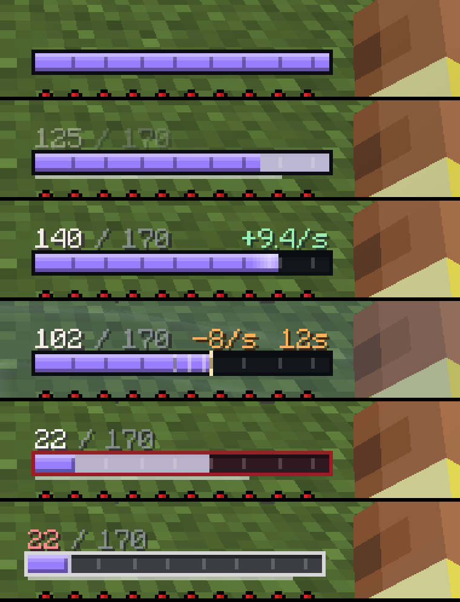

# Stamina and balance

Every power spends one stamina bar. This page is the rulebook and the table; `tools/balance.py` holds the same
rules as code and writes `data/heroesevolved/power_balance.json` and the skill numbers in `skill_trees.json`.
Change a number there and re-run it, not here.

## The bar

- **Size:** 100 at Power Level 1, 4 more each level: 136 at Level 10, 156 at 15, 176 at 20.
  Leveling is the permanent max-stamina upgrade path for every power; it does not require a particular item or build.
- **Practice:** a move costs 4% less for every Power Level since it unlocked, up to 30% off (eight levels
  later). A Level 1 move is at the cap by Level 9; an ultimate that opened at Level 15 is 16% off at Level 19.
  The table's numbers below are full price; the HUD and menus show what you actually pay. Rank III's 10% stacks
  on top. Held drains (Still World's per-second cost, flying) aren't discounted.
- **Recovery:** 3 a second at Level 1, 0.12 more each level (5.3 at Level 20), and **double** after five seconds
  without dealing or taking damage. It runs every tick, so the bar fills smoothly.
- **The pause:** spending stamina on a move stops recovery for 1.5 seconds. A fight is paid for out of the bar; the
  quiet afterwards refills it.
- **Held powers** drain a little every tick while they last, and end when the bar can't pay for the next tick. They
  don't restart the pause, so recovery works against a light drain (flying, Fade, Accelerate). Still World and
  Between Seconds hold recovery while they run: nothing comes back until time moves again.
- **Overexertion** is unchanged: hold Shift to use a move you can't afford, and pay in health, Weakness and Nausea.
- **Server config** (`energy` section): `baseEnergy`, `staminaPerPowerLevel`, `staminaRegenerationPerSecond`,
  `staminaRegenerationPerPowerLevel`, `staminaCalmRegenerationMultiplier`, `staminaRecoveryDelayTicks`, and
  `staminaCostScale` / `cooldownScale`, which multiply every cost and cooldown after the table.

## The HUD

The bar sits over the hunger bar in your power's colour, with a notch every 20 stamina so costs can be read off it.
What a move just took stays as a pale chunk that shrinks away. While stamina recovers a glint runs along the fill
and the right-hand number shows the rate (`+4.2/s`, green when calm); right after a move a thin line under the bar
counts down the pause. A held power draws moving stripes at the end of the fill and shows what it takes and how
long that leaves (`-12/s  9s`). Under a fifth the frame pulses red, and a move refused for lack of stamina flashes
and shakes the bar. Full and idle, the numbers fade away.

Photographed by `tools/stamina-preview.init.gradle` (`uitest/StaminaHudPreview`, flag `heroes.preview.stamina`).

## Held and distance costs

| Move | Cost |
| --- | --- |
| Still World | 20 to start (21 at Level 15 after its practice discount), then 12 a second at Level 6, 10 at
  Level 10, 8 at Level 15. It lasts until you press the key again or the stamina runs out (recovery stops
  meanwhile): about 8 s at Level 6, 11 at Level 10, 17 at Level 15 and 19 at Level 20 from a full bar. |
| Between Seconds | 10 to start, then 5 a second (4 at Level 15), recovery stopped; press again to end. |
| Fold Space | 4 to start plus 0.3 for every block folded, at full price: 9 for a 16-block fold, 28 for 80, 49
  for 150. Practice takes up to 30% off (35 for a 150-block fold at Level 15). |
| Breach to a frequency | The breach's own cost plus 1 for every 40 blocks to the frequency (up to 30 more), or 15
  more to another world. A breach where you look costs nothing extra. |
| Free Flight | 4 a second cruising, 9 boosting (recovery still runs). |
| Accelerate | 3 a second running, 6 in Redline. |
| Fade | 2 a second, +1 for each friend faded with you. |
| Glacier Ride | 8 a second moving, 4 standing. |
| Flame Flight | 10 a second moving, 6 hovering (4 with Pillar of Flame). |
| Live Current, Dragon's Breath, the held Canary Cry | 12-15 a second. |

## How a cost is worked out

Stamina pays for effect, measured at the tier the move unlocks:

- **2** per point of damage to one target. Damage over time counts 0.6 a point, a flurry 0.85, and a telegraphed or
  slow, dodgeable hit 0.75.
- **+40%** of that for each extra target a move usually catches, up to four.
- **3** per second of hard control (a hold, a root, a lift, a fear), with the same +40% per target.
- **0.35** per block a move carries you, plus 2.
- Utility (information, building, portals, shields) priced by judgement in the same units.
- **+15** for a tier-5 ultimate.

Each key has a band, so no key costs more or less than its place in the kit: slot 1 6-16, slot 2 10-26, slot 3
14-34, slot 4 16-40, slot 5 55-95. When the formula leaves the band, the cost is clamped and the move's **damage**
changes instead, so damage always follows stamina.

Cooldown follows cost by role, in seconds per point of stamina: basic 0.08 (at least half a second), quick 0.15,
skill 0.3, heavy 0.45, ultimate 0.75. Toggles and held powers get a short cooldown and pay by the second.

Damage scales with tier inside the code (4 + tier, 5 + 1.5 x tier...), a move gets cheaper with practice, and
the bar grows by 76%, so a move gets more for its stamina as you level, while the newest and biggest moves
stay at full price until you have had them a while.

## Unlock levels

One new key at each stage: Power Level 1, 3, 6, 10 and 15 (tiers 1 to 5). A kit whose first key is a toggle
(Free Flight, Accelerate, Fade, Shift) opens its second key at Level 1 too. Superspeed's Cyclone moved from
Level 10 to 6, and Flight's Meteor Drop and Skyhook from 6 and 10 to 3 and 6, so neither kit skips a stage.
Skill trees open by row: row 1 at Level 1, row 2 at Level 3, rows 3 and 4 at Level 6, row 5 at Level 10 and the
capstones at Level 15; signature skills at Level 10. Skill points are unchanged: 3 at Level 1, about one more
each level after (21 at Level 15, 28 Evolved), plus training and story notes, against 33 for a whole tree.

## Damage that changed

- **speed_cyclone**: Cyclone's wind: 2 + 0.5/tier every half second -> 1.2 + 0.3/tier (SpeedKit). It hit ultimate numbers (about 21 per target at Level 6) from a slot-4 key.
- **quake_0_1**: 7+tier -> 10+tier; airborne x2. Weighted damage at unlock: 6.75 -> 9; budget 10 from 23 stamina. Code: `quake/QuakeSkills#land`.
- **flight_2_1**: 2 -> 6 on the single updraft; second pulse needs an upgrade. Weighted damage at unlock: 1.5 -> 4.5; budget 4.57 from 23 stamina. Code: `flight/FlightSkillService#tickThermal`.
- **flight_thunderclap**: 4+Momentum*.05 -> 7+Momentum*.05. Weighted damage at unlock: 3 -> 5.25; budget 4.89 from 28 stamina. Code: `flight/FlightSkillService#tickVacuum`.
- **cryokinesis_0_1**: 6+tier -> 8+tier; one forged lance. Weighted damage at unlock: 6 -> 7.5; budget 9 from 24 stamina. Code: `cryo/CryoCombatSkills#tickForge`.
- **cryokinesis_2_1**: 2 -> 5 in Cold Snap's single wave. Weighted damage at unlock: 1.5 -> 3.75; budget 3.89 from 26 stamina. Code: `cryo/CryoCombatSkills#tick`.
- **cryokinesis_brittle_constellation**: 4 -> 6 per unique hop (strong: 7 -> 9). Weighted damage at unlock: 3.4 -> 5.1; budget 5.28 from 27 stamina. Code: `cryo/CryoTechniqueService#tickStars`.
- **electrokinesis_ground_sink**: 2+min(16,charge) -> 4+.5*min(16,charge). Weighted damage at unlock: 2 -> 4; budget 5.56 from 40 stamina. Code: `expansion/ExpansionSkills#activate`.
- **telekinesis_0_1**: 8 -> 10; one spear (second pierce needs a skill). Weighted damage at unlock: 8 -> 10; budget 11.5 from 23 stamina. Code: `telekinesis/TelekineticArsenalService#lance`.
- **time_manipulation_shared_blink**: 6+tier -> 2+tier, one cut per target. Weighted damage at unlock: 9 -> 5; budget 4.58 from 27 stamina. Code: `time/SpaceTimeSkills#edge`.
- **time_manipulation_singularity**: 9*(3+.5*tier) + (8+tier) collapse -> 9*(.6+.1*tier) + (3+.5*tier). Weighted damage at unlock: 36 -> 9.15; budget 10.5 from 51 stamina. Code: `time/SingularityService#pull,collapse`.
- **radiation_0_1**: 8+tier -> 4+.5*tier; 7 s stage-I sickness adds 3.5. Weighted damage at unlock: 12.1 -> 7.1; budget 6.79 from 19 stamina. Code: `radiation/RadiationSkills#lance`.
- **radiation_heat_vent**: 3+vented/5 -> 1.5+vented/30; 4 s burning. Weighted damage at unlock: 5.4 -> 3.9; budget 3.93 from 14 stamina. Code: `radiation/RadiationSkills#heatVent`.
- **pyrokinesis_1_1**: 8 pulses of 1.5 -> .1, plus up to 10 s of continually refreshed burning. Weighted damage at unlock: 13.2 -> 6.48; budget 6.43 from 26 stamina. Code: `pyro/PyroService#tickMantles`.
- **pyrokinesis_blue_lance**: (8+tier)*1.5 + up to four 2.5 trails -> (3+.5*tier)*1.5 + up to four .5 trails; 6 s burn. Weighted damage at unlock: 30.1 -> 12.3; budget 10 from 28 stamina. Code: `pyro/PyroService#blueLance,tickLances`.
- **invisibility_cloak_field**: (6+2*tier+1.5*held) -> same*.12 for Shell bubbles only; hold up to 3 s. Weighted damage at unlock: 12.4 -> 1.48; budget 1.86 from 28 stamina. Code: `invisibility/ForceFieldService#kineticShell,finishCrush`.
- **phasing_phase_carry**: five*(5+tier) -> five*(.8+.2*tier). Weighted damage at unlock: 34 -> 5.95; budget 6.11 from 25 stamina. Code: `phasing/Stones#damage,avalanche`.
- **vibe_rift_beast**: 45 s / 2 s attack interval; attack attribute 6+tier -> 1.8+.1*tier; random roll f/2+nextInt(int(f)). Weighted damage at unlock: 125 -> 21.1; budget 21 from 52 stamina. Code: `vibe/VibeBeast#summon; vanilla HoglinBase#hurtAndThrowTarget`.
- **hydro_pressure_jet**: 19*(1.5+.25*tier) -> 19*(.65+.1*tier) over 40 ticks, ages 2..38. Weighted damage at unlock: 28.5 -> 12; budget 12.5 from 25 stamina. Code: `hydro/HydroSkills#tickJet`.
- **amp_1_1**: 6+tier+spent/10 -> spent/30; enclosure and Second Coming x2 each. Weighted damage at unlock: 8 -> 0; budget 0 from 20 stamina. Code: `amplify/AmpSkills#vanFull`.
- **amp_doorbuster**: 3 -> 1.5 around the broken door; three-second stun. Weighted damage at unlock: 3 -> 1.5; budget 1.5 from 18 stamina. Code: `amplify/AmpSkills#doorbuster`.
- **radiation_ground_zero**: 10+2*tier+12*falloff -> 4+.6*tier+4*falloff; representative falloff .5; 8 s stage-I sickness. Weighted damage at unlock: 20.6 -> 8.84; budget 10.6 from 38 stamina. Code: `styles/StyleCasts (or the power's delegated class cast)`.
- **radiation_containment_dome**: 8 direct pulses 1 -> .3; repeating dose capped at stage I, 11 s exposure including tail. Weighted damage at unlock: 18.6 -> 4.74; budget 5 from 29 stamina. Code: `styles/StyleCasts (or the power's delegated class cast)`.
- **time_manipulation_hour_hand**: 9+2*tier -> 6+tier, one sweep per UUID. Weighted damage at unlock: 12.4 -> 7.43; budget 8.61 from 31 stamina. Code: `styles/StyleCasts (or the power's delegated class cast)`.
- **pyrokinesis_sunfall**: 12+2*tier -> 6+.75*tier, plus five seconds burning. Weighted damage at unlock: 17.9 -> 9.81; budget 9.72 from 35 stamina. Code: `styles/StyleCasts (or the power's delegated class cast)`.
- **cryokinesis_hailstorm**: 9 pulses (16..80 step 8): 3+.5*tier -> 1+.2*tier. Weighted damage at unlock: 26.7 -> 9.5; budget 9.72 from 35 stamina. Code: `styles/StyleCasts (or the power's delegated class cast)`.
- **electrokinesis_tesla_spire**: 12 pulses (10..120 step 10): 4+.5*tier -> .7+.15*tier. Weighted damage at unlock: 43.6 -> 9.11; budget 9.17 from 35 stamina. Code: `styles/StyleCasts (or the power's delegated class cast)`.
- **quake_fissure_maw**: 10+2*tier -> 7+tier, thrown set deduplicates the racing fissure. Weighted damage at unlock: 13.2 -> 8.25; budget 8.97 from 35 stamina. Code: `styles/StyleCasts (or the power's delegated class cast)`.
- **flight_tempest_drill**: 9+2*tier -> 5+.75*tier, hit set deduplicates the 18-block dash. Weighted damage at unlock: 16.5 -> 7.98; budget 8.11 from 31 stamina. Code: `styles/StyleCasts (or the power's delegated class cast)`.
- **telekinesis_implosion**: 12+2*tier -> 6+.75*tier after a 22-tick pull. Weighted damage at unlock: 14.9 -> 6.81; budget 8.07 from 35 stamina. Code: `styles/StyleCasts (or the power's delegated class cast)`.
- **telekinesis_debris_halo**: 17 pulses (0..160 step 10): 3 -> .35; blocks shots. Weighted damage at unlock: 30.6 -> 3.57; budget 3.89 from 26 stamina. Code: `styles/StyleCasts (or the power's delegated class cast)`.
- **telepathy_psychic_storm**: 7 pulses (0..120 step 20): 2+.5*tier -> .5+.3*tier. Weighted damage at unlock: 16.2 -> 6.47; budget 7.5 from 35 stamina. Code: `styles/StyleCasts (or the power's delegated class cast)`.
- **regeneration_vital_burst**: 10+2*tier -> 3+.5*tier; heals 2 per foe (capped 10) and also costs 4 health. Weighted damage at unlock: 17.6 -> 4.95; budget 5 from 28 stamina. Code: `styles/StyleCasts (or the power's delegated class cast)`.
- **sonic_resonance_resonance_cascade**: 12+2*tier -> 7+.75*tier after 16 ticks. Weighted damage at unlock: 14.9 -> 7.63; budget 8.89 from 35 stamina. Code: `styles/StyleCasts (or the power's delegated class cast)`.
- **invisibility_shadow_strike**: (8+tier)*1.5 -> 3.5+.5*tier, once per mark; three marks maximum. Weighted damage at unlock: 18.2 -> 5.5; budget 5.83 from 31 stamina. Code: `styles/StyleCasts (or the power's delegated class cast)`.
- **phasing_phase_eruption**: 10+2*tier -> 7+tier in Earthworks.barrage; the decorative columns deal zero. Weighted damage at unlock: 13.2 -> 8.25; budget 7.86 from 31 stamina. Code: `styles/StyleCasts (or the power's delegated class cast)`.
- **empathic_mimicry_prismatic_overflow**: 8+2*remembered+tier -> 4+.5*remembered+.75*tier; minimum remembered=1, plus 3 s burn. Weighted damage at unlock: 16.1 -> 9.23; budget 9.72 from 35 stamina. Code: `styles/StyleCasts (or the power's delegated class cast)`.
- **technopathy_drone_swarm**: 10 pulses (15..150 step 15): 2.5+.5*tier -> .8+.15*tier. Weighted damage at unlock: 26.4 -> 8.25; budget 8.61 from 31 stamina. Code: `styles/StyleCasts (or the power's delegated class cast)`.
- **technopathy_firewall**: 11 contacts (0..200 step 20): 3 -> .75; blocks shots. Weighted damage at unlock: 19.8 -> 4.95; budget 5 from 26 stamina. Code: `styles/StyleCasts (or the power's delegated class cast)`.
- **matter_assembly_forge_cannon**: 5 pulses (8,13,18,23,28): 5+tier -> 1.6+.25*tier. Weighted damage at unlock: 37.4 -> 11; budget 11.1 from 31 stamina. Code: `styles/StyleCasts (or the power's delegated class cast)`.
- **hydro_tsunami**: 10+2*tier -> 8+tier; one hit per rolling wave's struck UUID set. Weighted damage at unlock: 13.2 -> 9.08; budget 9.81 from 38 stamina. Code: `styles/StyleCasts (or the power's delegated class cast)`.
- **amp_lightning_cannon**: 10+2*tier -> 4+tier; redHit also stuns for 60 ticks. Weighted damage at unlock: 13.2 -> 5.78; budget 5.78 from 37 stamina. Code: `styles/StyleCasts (or the power's delegated class cast)`.
- **style_pyrokinesis_lead**: 2+.4*tier + 2 s ignition -> .8+.2*tier, no normal-jab ignition; loaded ignition remains. Weighted damage at unlock: 3.6 -> 1; budget 1 from 2 stamina. Code: `pyro/PyroCombat`.
- **style_pyrokinesis_rear**: 2+.4*tier + 2 s ignition -> .8+.2*tier, no normal-jab ignition; loaded ignition remains. Weighted damage at unlock: 3.6 -> 1; budget 1 from 2 stamina. Code: `pyro/PyroCombat`.
- **style_pyrokinesis_flourish**: 3+tier + 4 s ignition -> .4+.2*tier + 1 s ignition. Weighted damage at unlock: 7.4 -> 1.4; budget 1.39 from 5 stamina. Code: `pyro/PyroCombat`.
- **style_pyrokinesis_low**: unlock-tier low strike 3.5 -> 0.8. Weighted damage at unlock: 5.3 -> 1.4; budget 1.39 from 5 stamina. Code: `pyro/PyroCombat`.
- **style_electrokinesis_lead**: unlock-tier hit 2.4 -> 1; optional resource/counter multipliers retained. Weighted damage at unlock: 2.4 -> 1; budget 1 from 2 stamina. Code: `electro/ElectroCombat`.
- **style_electrokinesis_rear**: unlock-tier hit 2.4 -> 1; optional resource/counter multipliers retained. Weighted damage at unlock: 2.4 -> 1; budget 1 from 2 stamina. Code: `electro/ElectroCombat`.
- **style_electrokinesis_flourish**: unlock-tier finisher 5 -> 1.2. Weighted damage at unlock: 5 -> 1.2; budget 1.11 from 5 stamina. Code: `electro/ElectroCombat`.
- **style_electrokinesis_low**: unlock-tier low strike 3.5 -> 1.2. Weighted damage at unlock: 3.5 -> 1.2; budget 1.11 from 5 stamina. Code: `electro/ElectroCombat`.
- **style_hydrokinesis_lead**: 2+.4*tier -> .8+.2*tier; full-water baseline. Weighted damage at unlock: 2.4 -> 1; budget 1 from 2 stamina. Code: `hydro/HydroCombat`.
- **style_hydrokinesis_rear**: 2+.4*tier -> .8+.2*tier; full-water baseline. Weighted damage at unlock: 2.4 -> 1; budget 1 from 2 stamina. Code: `hydro/HydroCombat`.
- **style_hydrokinesis_flourish**: 5 daggers*(1.5+.3*tier) -> 5*(.35+.08*tier); all five may hit one body. Weighted damage at unlock: 8.92 -> 2.17; budget 2.5 from 5 stamina. Code: `hydro/HydroCombat`.
- **style_hydrokinesis_low**: unlock-tier low strike 3.5 -> 1.2. Weighted damage at unlock: 3.5 -> 1.2; budget 1.39 from 5 stamina. Code: `hydro/HydroCombat`.
- **style_superspeed_lead**: 3*(1+.3*tier) -> 3*(.3+.09*tier); all three invulnerability-reset hits land. Weighted damage at unlock: 3.31 -> 0.994; budget 1 from 2 stamina. Code: `speed/SpeedStyle`.
- **style_superspeed_rear**: 3*(1+.3*tier) -> 3*(.3+.09*tier); all three invulnerability-reset hits land. Weighted damage at unlock: 3.31 -> 0.994; budget 1 from 2 stamina. Code: `speed/SpeedStyle`.
- **style_superspeed_flourish**: unlock-tier finisher 5 -> 1.2. Weighted damage at unlock: 5 -> 1.2; budget 1.25 from 5 stamina. Code: `speed/SpeedStyle`.
- **style_superspeed_low**: unlock-tier low strike 3 -> 1. Weighted damage at unlock: 3 -> 1; budget 1.11 from 5 stamina. Code: `speed/SpeedStyle`.
- **style_quake_lead**: unlock-tier hit 2.4 -> 1; optional resource/counter multipliers retained. Weighted damage at unlock: 2.4 -> 1; budget 1 from 2 stamina. Code: `quake/QuakeStyle`.
- **style_quake_rear**: unlock-tier hit 2.4 -> 1; optional resource/counter multipliers retained. Weighted damage at unlock: 2.4 -> 1; budget 1 from 2 stamina. Code: `quake/QuakeStyle`.
- **style_quake_flourish**: unlock-tier finisher 5 -> 1.6. Weighted damage at unlock: 5 -> 1.6; budget 1.67 from 6 stamina. Code: `quake/QuakeStyle`.
- **style_quake_low**: unlock-tier low strike 3.5 -> 1.6. Weighted damage at unlock: 3.5 -> 1.6; budget 1.67 from 6 stamina. Code: `quake/QuakeStyle`.
- **style_cryokinesis_lead**: unlock-tier hit 2.4 -> 1; optional resource/counter multipliers retained. Weighted damage at unlock: 2.4 -> 1; budget 1 from 2 stamina. Code: `cryo/CryoStyle`.
- **style_cryokinesis_rear**: unlock-tier hit 2.4 -> 1; optional resource/counter multipliers retained. Weighted damage at unlock: 2.4 -> 1; budget 1 from 2 stamina. Code: `cryo/CryoStyle`.
- **style_cryokinesis_flourish**: unlock-tier finisher 6 -> 2. Weighted damage at unlock: 6 -> 2; budget 1.75 from 5 stamina. Code: `cryo/CryoStyle`.
- **style_cryokinesis_low**: unlock-tier low strike 2.8 -> 1. Weighted damage at unlock: 2.8 -> 1; budget 1.11 from 5 stamina. Code: `cryo/CryoStyle`.
- **style_phasing_lead**: 2.4+.35*tier -> .7+.15*tier, times Root. Weighted damage at unlock: 2.75 -> 0.85; budget 1 from 2 stamina. Code: `phasing/EarthStyle`.
- **style_phasing_rear**: (2.4+.35*tier)*1.4 -> (.7+.15*tier)*1.4; the rear hand always wears its gauntlet, times Root. Weighted damage at unlock: 3.85 -> 1.19; budget 1 from 2 stamina. Code: `phasing/EarthStyle`.
- **style_phasing_flourish**: unlock-tier finisher 6.5 -> 1.2. Weighted damage at unlock: 6.5 -> 1.2; budget 1.11 from 5 stamina. Code: `phasing/EarthStyle`.
- **style_phasing_low**: unlock-tier low strike 2.8 -> 1. Weighted damage at unlock: 2.8 -> 1; budget 1.11 from 5 stamina. Code: `phasing/EarthStyle`.
- **style_regeneration_lead**: unlock-tier hit 3.5 -> 1; optional resource/counter multipliers retained. Weighted damage at unlock: 3.5 -> 1; budget 1 from 2 stamina. Code: `regeneration/RegenStyle`.
- **style_regeneration_rear**: unlock-tier hit 3.5 -> 1; optional resource/counter multipliers retained. Weighted damage at unlock: 3.5 -> 1; budget 1 from 2 stamina. Code: `regeneration/RegenStyle`.
- **style_regeneration_flourish**: unlock-tier finisher 6 -> 2. Weighted damage at unlock: 6 -> 2; budget 2 from 5 stamina. Code: `regeneration/RegenStyle`.
- **style_regeneration_low**: unlock-tier low strike 4 -> 1.6. Weighted damage at unlock: 4 -> 1.6; budget 2 from 5 stamina. Code: `regeneration/RegenStyle`.
- **style_invisibility_lead**: unlock-tier hit 2.4 -> 1; optional resource/counter multipliers retained. Weighted damage at unlock: 2.4 -> 1; budget 1 from 2 stamina. Code: `invisibility/ForceStyle`.
- **style_invisibility_rear**: unlock-tier hit 2.4 -> 1; optional resource/counter multipliers retained. Weighted damage at unlock: 2.4 -> 1; budget 1 from 2 stamina. Code: `invisibility/ForceStyle`.
- **style_invisibility_flourish**: unlock-tier finisher 5 -> 1.2. Weighted damage at unlock: 5 -> 1.2; budget 1.39 from 5 stamina. Code: `invisibility/ForceStyle`.
- **style_invisibility_low**: unlock-tier low strike 3.5 -> 1.2. Weighted damage at unlock: 3.5 -> 1.2; budget 1.39 from 5 stamina. Code: `invisibility/ForceStyle`.
- **style_telekinesis_lead**: 2+.3*tier -> .5+.1*tier; collision adds .5x to body and .8x to next foe. Weighted damage at unlock: 4.54 -> 1.09; budget 1 from 2 stamina. Code: `telekinesis/KineticStyle`.
- **style_telekinesis_rear**: 2+.3*tier -> .5+.1*tier; collision adds .5x to body and .8x to next foe. Weighted damage at unlock: 4.54 -> 1.09; budget 1 from 2 stamina. Code: `telekinesis/KineticStyle`.
- **style_telekinesis_flourish**: lift 1.5+.2*tier + slam 4+tier -> .4+.1*tier + .8+.2*tier; hangs 9 ticks. Weighted damage at unlock: 6.71 -> 1.53; budget 1.82 from 5 stamina. Code: `telekinesis/KineticStyle`.
- **style_telekinesis_low**: unlock-tier low strike 2.3 -> 1.2. Weighted damage at unlock: 2.3 -> 1.2; budget 1.39 from 5 stamina. Code: `telekinesis/KineticStyle`.
- **style_vibe_lead**: 2+.4*tier -> .6+.15*tier; secondary 1+.3*tier -> .3+.1*tier, counted at 40%. Weighted damage at unlock: 2.92 -> 0.91; budget 1 from 2 stamina. Code: `vibe/VibeStyle`.
- **style_vibe_rear**: 2+.4*tier -> .6+.15*tier; secondary 1+.3*tier -> .3+.1*tier, counted at 40%. Weighted damage at unlock: 2.92 -> 0.91; budget 1 from 2 stamina. Code: `vibe/VibeStyle`.
- **style_vibe_flourish**: unlock-tier finisher 5.5 -> 2.5. Weighted damage at unlock: 5.5 -> 2.5; budget 2.5 from 5 stamina. Code: `vibe/VibeStyle`.
- **style_vibe_low**: unlock-tier low strike 3.5 -> 1.2. Weighted damage at unlock: 3.5 -> 1.2; budget 1.11 from 5 stamina. Code: `vibe/VibeStyle`.
- **radiation_1_1**: repeated doses stacking to amplifier 5 -> stage-I dose only when not already sick; at most 13 s stage I including tail. Weighted damage at unlock: 21.6 -> 3.9; budget 3.5 from 23 stamina. Code: `radiation/RadiationSkills#onHurt`.
- **phasing_2_1**: 6+tier -> 3+tier on surfacing; Uproot doubles a previously embedded target. Weighted damage at unlock: 8 -> 5; budget 4.61 from 19 stamina. Code: `phasing/DensityService#surface`.
- **electrokinesis_faraday_cage**: 4 -> .5 per incoming melee hit; 6 s ward, representative 2 attacks/s. Weighted damage at unlock: 48 -> 6; budget 6 from 26 stamina. Code: `styles/StyleRuntime#incoming`.
- **pyrokinesis_ember_shroud**: 3 -> .125 per incoming melee hit; ignition 4 -> 1 s, 8 s ward at 2 attacks/s. Weighted damage at unlock: 54.6 -> 6.8; budget 7 from 26 stamina. Code: `styles/StyleRuntime#incoming`.
- **style_pyrokinesis_counter**: loaded (.8+.2*tier)*2.2; ignition 5 -> 1 s (normal strike's old base 2+.4*tier). Weighted damage at unlock: 8.28 -> 2.8; budget 2.16 from 8 stamina. Code: `pyro/PyroCombat`.
- **style_electrokinesis_counter**: loaded (2+.4*tier)*1.6 -> (.8+.2*tier)*1.5; three .7x hops add .84x at 40% spread. Weighted damage at unlock: 7.07 -> 2.76; budget 2.21 from 8 stamina. Code: `electro/ElectroCombat`.
- **style_hydrokinesis_counter**: loaded (2+.4*tier)*1.6 -> (.8+.2*tier)*1.6, plus a short pull. Weighted damage at unlock: 3.84 -> 1.6; budget 1.82 from 8 stamina. Code: `hydro/HydroCombat`.
- **style_superspeed_counter**: 6*(.9+.3*tier) -> 6*(.18+.06*tier). Weighted damage at unlock: 6.12 -> 1.22; budget 1.12 from 6 stamina. Code: `speed/SpeedStyle`.
- **style_quake_counter**: Rebound 4+tier -> .8+.2*tier PLUS a loaded 1.8x palm. Weighted damage at unlock: 9.32 -> 2.8; budget 2.3 from 8 stamina. Code: `quake/QuakeStyle`.
- **style_cryokinesis_counter**: loaded (2+.4*tier)*1.6*2 -> (.8+.2*tier)*1.2*2; hitting shatters and ENDS the 40-tick freeze. Weighted damage at unlock: 7.68 -> 2.4; budget 2.15 from 8 stamina. Code: `cryo/CryoStyle`.
- **style_phasing_counter**: pillar 1.5+.5*tier -> .5+.2*tier PLUS (.7+.15*tier)*1.4 gauntlet*1.5 loaded; Root is conditional. Weighted damage at unlock: 7.77 -> 2.48; budget 2.39 from 8 stamina. Code: `phasing/EarthStyle`.
- **style_invisibility_counter**: five shards*(2+.4*tier) -> five*(.4+.1*tier), StyleHits resets invulnerability for each. Weighted damage at unlock: 10.2 -> 2.12; budget 2.3 from 8 stamina. Code: `invisibility/ForceStyle`.
- **style_telekinesis_counter**: loaded swat 2x base; body collision 1.5 -> .5x damage and a second foe .8x, weighted .4; swat ENDS the grip. Weighted damage at unlock: 7.57 -> 2.18; budget 2.15 from 8 stamina. Code: `telekinesis/KineticStyle`.
- **style_vibe_counter**: 4+tier -> 1.5+.5*tier, from a tear behind the attacker. Weighted damage at unlock: 5 -> 2; budget 2.37 from 8 stamina. Code: `vibe/VibeStyle`.
- **style_pyrokinesis_back_dodge**: flip 3+.6*tier -> 1+.3*tier; ignition 3 -> 1 s. Weighted damage at unlock: 6 -> 2.2; budget 2.65 from 11 stamina. Code: `pyro/PyroCombat`.
- **style_hydrokinesis_back_dodge**: Geyser Vault 3+.6*tier -> 1.5+.25*tier. Weighted damage at unlock: 4.2 -> 2; budget 1.9 from 11 stamina. Code: `hydro/HydroCombat`.

## Core moves

### Telepathy

| Key | Move | Level | Stamina | Cooldown | Was | Pays for |
| --- | --- | --- | --- | --- | --- | --- |
| 1 | `telepathy_read_mind` | 1 | 8 + 2/s | 0.75s | 7 / 0.7s, Level 1 | held read; builds Focus; 2 a second while held (up to 6 s) |
| 2 | `telepathy_suggestion` | 3 | 21 | 9.5s | 25 / 12s, Level 3 | a 5 s command on one mind |
| 3 | `telepathy_mind_link` | 6 | 18 | 5.5s | 27 / 0.6s, Level 6 | links willing minds (no damage) |
| 4 | `telepathy_puppet` | 10 | 40 | 30s | 50 / 51.75s, Level 10 | about 10 s in control of a body |
| 5 | `telepathy_nightmare` | 15 | 63 | 47s | 72 / 63s, Level 15 | 5 s of fear on everyone linked |

### Superspeed

| Key | Move | Level | Stamina | Cooldown | Was | Pays for |
| --- | --- | --- | --- | --- | --- | --- |
| 1 | `speed_accelerate` | 1 | 0 | 0s | 0 / 0s, Level 1 | toggle; 3 a second while running (6 in Redline) |
| 2 | `speed_blitz` | 1 | 23 | 2.5s | 14 / 2s, Level 1 | four blows of 2.5 after a 22-block rush (a gap-closer: half its distance counts) |
| 3 | `speed_snatch` | 3 | 16 | 4.75s | 20 / 10s, Level 3 | takes items, shots and a weapon |
| 4 | `speed_cyclone` | 6 | 38 + 4/s | 17s | 30 / 12s, Level 10 | 3 s of wind: 1.2 + 0.3/tier every half second, lift, no air; 4/s throughout the owned vortex, including its first ticks and anchored storm; Wind Arms on the same key also drains 4/s |
| 5 | `speed_lightspeed` | 15 | 88 | 66s | 50 / 45s, Level 15 | 8 + tier + Momentum/5 to everything on a 48-block line |

### Regeneration

| Key | Move | Level | Stamina | Cooldown | Was | Pays for |
| --- | --- | --- | --- | --- | --- | --- |
| 1 | `regeneration_rapid_mending` | 1 | 16 | 15s | 25 / 25s, Level 1 | spends Regrowth on an instant heal (Regrowth limits it) |
| 2 | `regeneration_blood_gift` | 3 | 16 | 4.75s | 21 / 22.5s, Level 3 | heals a friend; held, a stream |
| 3 | `regeneration_indestructible` | 6 | 32 | 14s | 40 / 60s, Level 6 | 10 s: no knockback, dulled pain, hard punches |
| 4 | `regeneration_healing_aura` | 10 | 34 | 15s | 36 / 36s, Level 10 | 10 s: friends heal with you; you share their wounds |
| 5 | `regeneration_second_life` | 15 | 55 | 90s | 40 / 90s, Level 15 | a friend heals fully and cheats death once (also 50 Regrowth) |

### Flight

| Key | Move | Level | Stamina | Cooldown | Was | Pays for |
| --- | --- | --- | --- | --- | --- | --- |
| 1 | `flight_toggle` | 1 | 0 | 0s | 0 / 0s, Level 1 | toggle; 4 a second cruising, 9 boosting |
| 2 | `flight_launch` | 1 | 12 | 1.75s | 18 / 3s, Level 1 | Skyburst: a dash of up to 20 blocks |
| 3 | `flight_dive_bomb` | 3 | 25 | 7.5s | 28 / 6s, Level 6 | 5 + tier + Momentum on landing, a pressure wave |
| 4 | `flight_skyward_grab` | 6 | 21 | 6.25s | 30 / 5s, Level 10 | seize and carry, then a throw |
| 5 | `flight_cyclone` | 15 | 70 + 12/s | 52s | 47 / 22.5s, Level 15 | Tempest: lifts and bursts everything round its eye; 12/s while the storm runs |

### Electrokinesis

| Key | Move | Level | Stamina | Cooldown | Was | Pays for |
| --- | --- | --- | --- | --- | --- | --- |
| 1 | `electro_chain_lightning` | 1 | 15 | 1.25s | 18 / 1.5s, Level 1 | 4 + 1.5/tier, chaining at 75% |
| 2 | `electro_ball_lightning` | 3 | 25 | 7.5s | 25 / 3s, Level 3 | an orb that lashes (3 + tier) and bursts (5 + tier) |
| 3 | `electro_thunderstrike` | 6 | 27 | 8s | 39 / 8s, Level 6 | 4 + 2/tier where you marked |
| 4 | `electro_ride_the_lightning` | 10 | 30 | 9s | 30 / 5s, Level 10 | a bolt's dash; 4 + tier to what you pass |
| 5 | `electro_storm_surge` | 15 | 72 | 54s | 94 / 72s, Level 15 | 8 + tier + Charge to everything round you |

### Vibe

| Key | Move | Level | Stamina | Cooldown | Was | Pays for |
| --- | --- | --- | --- | --- | --- | --- |
| 1 | `vibe_blast` | 1 | 4 + 9/s | 0.5s | 9 / 1.1s, Level 1 | held blast: 1.2 + 0.35/tier every 6 ticks while it drains |
| 2 | `vibe_breach` | 3 | 20 | 6s | 20 / 6.5s, Level 3 | two-way portals |
| 3 | `vibe_read` | 6 | 14 | 4.25s | 12 / 5s, Level 6 | replays a scene's fights |
| 4 | `vibe_breach_guard` | 10 | 22 | 6.5s | 21 / 8.5s, Level 10 | a moving breach that swallows shots |
| 5 | `vibe_frequency_lock` | 15 | 58 | 44s | 42 / 17s, Level 15 | Rift Fall: everyone in the ring drops out of a sky breach, 6 + 2/tier and a slow |

### Matter Assembly

| Key | Move | Level | Stamina | Cooldown | Was | Pays for |
| --- | --- | --- | --- | --- | --- | --- |
| 1 | `matter_assembly_barricade` | 1 | 12 | 3.5s | 12 / 3s, Level 1 | a 3x2 wall (also costs material) |
| 2 | `matter_assembly_shard_lance` | 1 | 12 | 1s | 14 / 1.5s, Level 1 | a shard up to 64 blocks |
| 3 | `matter_assembly_causeway` | 3 | 20 | 6s | 22 / 8s, Level 3 | 8 s of walking on air |
| 4 | `matter_assembly_cage` | 6 | 22 | 10s | 30 / 11s, Level 6 | a cell round one enemy |
| 5 | `matter_assembly_cathedral` | 15 | 70 | 52s | 70 / 50s, Level 15 | three turrets for 20 s |

### Invisibility

| Key | Move | Level | Stamina | Cooldown | Was | Pays for |
| --- | --- | --- | --- | --- | --- | --- |
| 1 | `invisibility_fade` | 1 | 6 | 0.5s | 6 / 0.5s, Level 1 | toggle; 2 a second, +1 per friend |
| 2 | `invisibility_silent_step` | 1 | 14 | 2s | 14 / 4s, Level 1 | Lens Shield: 3 s, 70% off frontal harm, stops shots |
| 3 | `invisibility_unseen_strike` | 3 | 14 | 2s | 16 / 4s, Level 3 | Force Bridge: a 12-block span |
| 4 | `invisibility_shroud` | 6 | 29 | 13s | 25 / 10s, Level 6 | Bubble: 5 s hold, then a crush (6 + 2/tier) |
| 5 | `invisibility_ghost_protocol` | 15 | 77 | 58s | 90 / 90s, Level 15 | Force Nova: heavy damage and a throw in 12 blocks |

### Telekinesis

| Key | Move | Level | Stamina | Cooldown | Was | Pays for |
| --- | --- | --- | --- | --- | --- | --- |
| 1 | `telekinesis_push` | 1 | 8 | 0.75s | 12 / 1.5s, Level 1 | a shove (2 + tier/4) |
| 2 | `telekinesis_grip` | 3 | 24 | 7.25s | 30 / 10s, Level 3 | hold, then a throw |
| 3 | `telekinesis_bullet_stop` | 6 | 22 | 10s | 32 / 21s, Level 6 | catches every shot, then turns them |
| 4 | `telekinesis_disarm` | 10 | 16 | 4.75s | 20 / 8s, Level 10 | tears a weapon away |
| 5 | `telekinesis_storm` | 15 | 79 | 59s | 94 / 72s, Level 15 | lifts and slams everyone round you |

### Hydrokinesis

| Key | Move | Level | Stamina | Cooldown | Was | Pays for |
| --- | --- | --- | --- | --- | --- | --- |
| 1 | `hydro_water_whip` | 1 | 10 | 0.75s | 10 / 0.7s, Level 1 | 4 + tier along your aim |
| 2 | `hydro_crashing_wave` | 1 | 22 | 6.5s | 26 / 6s, Level 1 | 5 + tier to what it carries |
| 3 | `hydro_octopus_form` | 3 | 30 | 14s | 30 / 14s, Level 3 | 10 s: arms lash (6 + tier), shots swallowed, a third off blows |
| 4 | `hydro_wave_rider` | 6 | 20 | 6s | 22 / 8s, Level 6 | 6 s of surfing |
| 5 | `hydro_maelstrom` | 15 | 79 + 12/s | 59s | 95 / 75s, Level 15 | a waterspout that drags and drowns; 12/s while the storm runs |

### Power Amplification

| Key | Move | Level | Stamina | Cooldown | Was | Pays for |
| --- | --- | --- | --- | --- | --- | --- |
| 1 | `amp_supercharge` | 1 | 14 | 4.25s |  | 15 s Surge on an ally (+25% harm, -25% cost and cooldowns); held, an Overcharge (50 Charge) |
| 2 | `amp_red_lightning` | 1 | 11 | 1s |  | a bolt of 4 + tier (more with Charge), or a beam through a line |
| 3 | `amp_shock_therapy` | 3 | 14 | 2s |  | clears mind control, stuns and slows; stands a downed friend up |
| 4 | `amp_jumpstart` | 6 | 16 | 2.5s |  | doors, levers, furnaces x4 for 30 s, batteries, a mount x2 |
| 5 | `amp_thousand_times` | 15 | 60 | 45s |  | every ally within 10 blocks overcharged, no backlash |

### Technopathy

| Key | Move | Level | Stamina | Cooldown | Was | Pays for |
| --- | --- | --- | --- | --- | --- | --- |
| 1 | `technopathy_handshake` | 1 | 8 | 0.75s | 8 / 1s, Level 1 | enrols a network |
| 2 | `technopathy_remote_hand` | 1 | 5 | 0.6s | 5 / 0.6s, Level 1 | works a linked device |
| 3 | `technopathy_tripwire` | 3 | 16 | 4.75s | 20 / 3.5s, Level 3 | a trap: 6 + tier and a stumble |
| 4 | `technopathy_intercept` | 6 | 24 | 11s | 30 / 12s, Level 6 | 10 s of arrow diversion |
| 5 | `technopathy_machine_city` | 15 | 75 | 56s | 85 / 60s, Level 15 | 12 s of a defended district |

### Shapeshifting

| Key | Move | Level | Stamina | Cooldown | Was | Pays for |
| --- | --- | --- | --- | --- | --- | --- |
| 1 | `shapeshift_morph` | 1 | 0 | 1s | 0 / 1s, Level 1 | a form pays its own size cost and drain |
| 2 | `shapeshift_instinct` | 3 | 0 | 0.3s | 0 / 0.3s, Level 3 | each form's move pays its own cost |
| 3 | `shapeshift_decoy` | 6 | 16 | 4.75s | 16 / 10s, Level 6 | a shell that draws the hunt for 6 s |
| 4 | `shapeshift_reflection` | 10 | 21 | 6.25s | 18 / 12s, Level 10 | become your attacker; its kind forget you |
| 5 | `shapeshift_nightmare` | 15 | 55 | 41s | 40 / 30s, Level 15 | 5 s of fear in 12 blocks |

### Pyrokinesis

| Key | Move | Level | Stamina | Cooldown | Was | Pays for |
| --- | --- | --- | --- | --- | --- | --- |
| 1 | `pyro_flare` | 1 | 16 | 1.25s | 14 / 1.25s, Level 1 | 4 + tier and 4 s burning, splashing nearby |
| 2 | `pyro_flame_palm` | 1 | 8 | 3s | 12 / 4s, Level 1 | held cone; 12 a second while breathing |
| 3 | `pyro_ring_of_fire` | 3 | 27 | 12s | 35 / 15s, Level 3 | an 8 s wall of flame (4 + tier) that draws burning foes in |
| 4 | `pyro_backdraft` | 6 | 12 | 4s | 25 / 5s, Level 6 | Flame Flight toggle; 6-10 a second |
| 5 | `pyro_inferno` | 15 | 68 | 51s | 76 / 48s, Level 15 | Sunfall: a charged sun on the marked area |

### Cryokinesis

| Key | Move | Level | Stamina | Cooldown | Was | Pays for |
| --- | --- | --- | --- | --- | --- | --- |
| 1 | `cryo_frost_bolt` | 1 | 8 | 1s | 14 / 1s, Level 1 | held stream; pulses pay as they go |
| 2 | `cryo_flash_freeze` | 3 | 18 | 5.5s | 35 / 15s, Level 3 | an ice wall or ramp |
| 3 | `cryo_ice_wall` | 6 | 12 | 4s | 20 / 4s, Level 6 | Glacier Ride toggle; 4-8 a second |
| 4 | `cryo_glacial_spikes` | 10 | 27 | 12s | 30 / 10s, Level 10 | Crystal Prison: a hold, then a shatter (5 + tier) |
| 5 | `cryo_blizzard` | 15 | 79 | 59s | 88 / 72s, Level 15 | Whiteout |

### Empathic Mimicry

| Key | Move | Level | Stamina | Cooldown | Was | Pays for |
| --- | --- | --- | --- | --- | --- | --- |
| 1 | `mimicry_echo_1` | 1 | copied | copied x1.5 | 0 / 1s, Level 1 | pays the copied move's own cost |
| 2 | `mimicry_echo_2` | 3 | copied | copied x1.5 | 0 / 1s, Level 3 | pays the copied move's own cost |
| 3 | `mimicry_echo_3` | 6 | copied | copied x1.5 | 0 / 1s, Level 6 | pays the copied move's own cost |
| 4 | `mimicry_echo_4` | 10 | copied | copied x1.5 | 0 / 1s, Level 10 | pays the copied move's own cost |
| 5 | `mimicry_echo_5` | 15 | copied | copied x1.5 | 0 / 1s, Level 15 | pays the copied move's own cost |

### Radiation

| Key | Move | Level | Stamina | Cooldown | Was | Pays for |
| --- | --- | --- | --- | --- | --- | --- |
| 1 | `radiation_radiant_touch` | 1 | 14 | 1s | 15 / 1s, Level 1 | a cone of 3 + tier to up to six |
| 2 | `radiation_pulse` | 3 | 22 | 6.5s | 26 / 6.4s, Level 3 | Fission Leap: a blast and a launch; the slam is free |
| 3 | `radiation_emp` | 6 | 20 | 9s | 24 / 14s, Level 6 | kills machines for 10 s, shoves, reveals, vents Core |
| 4 | `radiation_meltdown_beam` | 10 | 18 + 12/s | 6s | 25 / 6s, Level 10 | a held beam that spends Core; 12 a second while held (up to 5 s) |
| 5 | `radiation_exploding_man` | 15 | 120 | 300s | 140 / 450s, Level 15 | Critical Mass: a 24-block nuclear blast after 25 s |

### Phasing

| Key | Move | Level | Stamina | Cooldown | Was | Pays for |
| --- | --- | --- | --- | --- | --- | --- |
| 1 | `phasing_shift` | 1 | 4 + 3.3/s | 0.3s | 4 / 0.3s, Level 1 | Horse Stance toggle; holding it drains 3.3 a second (half with Wait and Listen). Shift: Seismic Stomp |
| 2 | `phasing_reach` | 1 | 14 | 2s | 16 / 3s, Level 1 | Rock Strike: lift a stone (6 + tier) or hold for a boulder; the punch is free |
| 3 | `phasing_embed` | 3 | 19 | 5.75s | 24 / 10s, Level 3 | Earth Shackle: a 3 + tier s hold, 50% more taken; Crush (4 + tier) is free |
| 4 | `phasing_sink` | 6 | 20 | 3s | 20 / 2s, Level 6 | Pillar (4 + tier and a throw, or a lift for you) or a wall that stops shots and shoves (5 + tier) |
| 5 | `phasing_hollow` | 15 | 80 | 60s | 60 / 45s, Level 15 | Rising Mountain: a telegraphed lift and slam, 8 + 2/tier to all on it |

### Time Manipulation

| Key | Move | Level | Stamina | Cooldown | Was | Pays for |
| --- | --- | --- | --- | --- | --- | --- |
| 1 | `time_blink` | 1 | 4 + 0.3/block | 1.5s | 25 / 6s, Level 1 | Fold Space: 4 to start, 0.3 for every block folded |
| 2 | `time_slow` | 1 | 10 + 5/s | 2s | 56 / 27s, Level 1 | Between Seconds: held, 5 a second (recovery stops) |
| 3 | `time_stop` | 6 | 20 + 12/s | 10s | 60 / 31.5s, Level 6 | Still World: held, 12/10/8 a second by tier (recovery stops) |
| 4 | `time_rewind` | 10 | 120 | 240s | 130 / 240s, Level 10 | Rewrite the Moment: most of a tank, a long recovery |
| 5 | `temporal_snapshot` | 15 | 35 | 30s | 40 / 30s, Level 15 | Walk the Past: travel 35, recording 18, return free |

### Sonic Resonance

| Key | Move | Level | Stamina | Cooldown | Was | Pays for |
| --- | --- | --- | --- | --- | --- | --- |
| 1 | `sonic_cry` | 1 | 12 | 1s | 18 / 1.25s, Level 1 | tap: 4 + 1.2/tier in a narrow cone; held: 12 a second |
| 2 | `sonic_note` | 3 | 14 | 4.25s | 16 / 4.8s, Level 3 | a lure that plays 8 s |
| 3 | `sonic_wall` | 6 | 22 | 10s | 23 / 11.25s, Level 6 | 5 s that turns shots back |
| 4 | `sonic_vault` | 10 | 16 | 2.5s | 25 / 4s, Level 10 | a leap and a safe landing |
| 5 | `sonic_crescendo` | 15 | 68 | 51s | 48 / 48s, Level 15 | a charged cone, 6 + 10 x charge + tier, after up to 3 s of build |

### Quake

| Key | Move | Level | Stamina | Cooldown | Was | Pays for |
| --- | --- | --- | --- | --- | --- | --- |
| 1 | `quake_shockwave` | 1 | 13 | 1s | 15 / 1.5s, Level 1 | 3 + 1.5/tier, a throw, shots shaken to dust |
| 2 | `quake_resonate` | 3 | 24 | 7.25s | 18 / 8s, Level 3 | 3 s of shaking (1.5 + tier/2 a pulse), a stagger |
| 3 | `quake_fault_line` | 6 | 28 | 8.5s | 30 / 4.8s, Level 6 | a racing crack: (4 + tier) and a launch |
| 4 | `quake_blast` | 10 | 10 | 0s | 10 / 0s, Level 10 | held beam; it drains per second |
| 5 | `quake_earthquake` | 15 | 81 | 61s | 102 / 78s, Level 15 | seconds of shaking, then an aftershock |

## Fighting styles

Strikes 2, finishers (kicks, claps, flourishes) 5 (Pressure Palm 6), dodges 8 and back dodges 11 (a speedster's
6 and 9, the Reckless Brawler's brace 6 and 9), and 0.9 s between dodges (0.7 s for a speedster). Every one pauses
recovery, so a long exchange of blows is paid for.

## Finishers

Every finisher costs 8 stamina and shares one 3 s cooldown across all powers; a finished
foe gives 10 stamina back. Entries: `finisher_pyrokinesis`, `finisher_time_manipulation`, `finisher_telepathy`, `finisher_electrokinesis`, `finisher_hydrokinesis`, `finisher_cryokinesis`, `finisher_quake`, `finisher_sonic_resonance`, `finisher_radiation`, `finisher_superspeed`, `finisher_flight`, `finisher_telekinesis`, `finisher_phasing`, `finisher_invisibility`, `finisher_regeneration`, `finisher_vibe`, `finisher_technopathy`, `finisher_matter_assembly`, `finisher_empathic_mimicry`, `finisher_shapeshifting`, `finisher_power_amplification`.

## Skill-tree and class abilities

Actives keep their designed order and are pulled 30% toward the middle of their band, then clamped: early actives
(row 2) 12-26, later actives 14-32, signatures 45-60, Offense classes 28-40, Defense and Support 22-34. A skill's
cooldown is held between 0.2 and 0.8 seconds per stamina (25-45 s for a signature), a class ability's between 0.45
and 0.75.

| Power | Skill | Kind | Stamina | Cooldown |
| --- | --- | --- | --- | --- |
| quake | Seismic Lance | skill | 23 (was 24) | 4.5s |
| quake | Fault Script | skill | 20 (was 18) | 4s |
| quake | Vibration Shell | skill | 26 (was 30) | 12s |
| quake | Counterforce | skill | 17 (was 14) | 3.5s (was 1s) |
| quake | Pressure Step | skill | 21 (was 22) | 5s |
| quake | Surgical Fracture | skill | 21 (was 20) | 6s |
| quake | Fissure Maw | class:offense | 35 | 18s |
| quake | Stone Rampart | class:defense | 26 (was 25) | 19.5s (was 22s) |
| quake | Bedrock Stance | class:support | 26 (was 25) | 19.5s (was 24s) |
| flight | Rescue Rush | skill | 20 | 6s |
| flight | Wind Sanctuary | skill | 27 (was 28) | 12s |
| flight | Barrel Roll | skill | 19 (was 18) | 5s |
| flight | Jetstream | skill | 24 | 10s |
| flight | Thermal Lance | skill | 23 (was 24) | 8s |
| flight | Vacuum Clap | skill | 28 (was 30) | 9s |
| flight | Tempest Drill | class:offense | 31 (was 30) | 15s |
| flight | Gale Wall | class:defense | 26 (was 25) | 19.5s (was 22s) |
| flight | Formation Flight | class:support | 26 (was 25) | 19.5s (was 24s) |
| cryokinesis | Crystal Lance | skill | 24 (was 26) | 5s |
| cryokinesis | Rime Loom | skill | 24 | 7s |
| cryokinesis | Frost Armor | skill | 26 (was 30) | 13s |
| cryokinesis | Stillheart Cocoon | skill | 25 (was 26) | 12s |
| cryokinesis | Cold Snap | skill | 26 (was 32) | 9s |
| cryokinesis | Brittle Constellation | skill | 27 (was 28) | 9s |
| cryokinesis | Hailstorm | class:offense | 35 | 20s |
| cryokinesis | Crystal Bastion | class:defense | 29 (was 30) | 21.75s (was 24s) |
| cryokinesis | Aurora Veil | class:support | 26 (was 25) | 19.5s (was 26s) |
| electrokinesis | Arc Lance | skill | 26 (was 28) | 5.25s (was 5s) |
| electrokinesis | Circuit Thread | skill | 23 (was 22) | 5s |
| electrokinesis | Static Screen | skill | 26 (was 28) | 11s |
| electrokinesis | Ground Sink | skill | 20 (was 18) | 4s (was 2s) |
| electrokinesis | Blackout | skill | 47 (was 45) | 30s |
| electrokinesis | Overcharge | skill | 24 (was 25) | 11s |
| electrokinesis | Arc Lattice | skill | 14 (was 10) | 2.75s (was 1s) |
| electrokinesis | Tesla Spire | class:offense | 35 | 20s |
| electrokinesis | Faraday Cage | class:defense | 26 (was 25) | 19.5s (was 22s) |
| electrokinesis | Jumpstart | class:support | 22 (was 20) | 16.5s (was 18s) |
| telekinesis | Vector Lance | skill | 23 (was 24) | 5s |
| telekinesis | Remote Hand | skill | 14 (was 8) | 2.75s (was 2s) |
| telekinesis | Gravity Well | skill | 26 (was 35) | 12s |
| telekinesis | Kinetic Volley | skill | 24 | 6s |
| telekinesis | Vector Step | skill | 21 (was 22) | 8s |
| telekinesis | Force Bubble | skill | 28 (was 30) | 15s |
| telekinesis | Implosion | class:offense | 35 | 20s |
| telekinesis | Debris Halo | class:defense | 26 (was 25) | 19.5s (was 22s) |
| telekinesis | Gathering Hand | class:support | 26 (was 25) | 19.5s (was 20s) |
| telepathy | Drop It | skill | 21 (was 22) | 8s |
| telepathy | Persuasion | skill | 32 (was 40) | 20s |
| telepathy | Far Hearing | skill | 19 (was 18) | 15.25s (was 20s) |
| telepathy | Memory Walk | skill | 20 (was 18) | 10s |
| telepathy | Dream Double | skill | 26 (was 32) | 9s |
| telepathy | Hive Link | skill | 25 (was 26) | 20s (was 30s) |
| telepathy | Psychic Storm | class:offense | 35 | 22s |
| telepathy | Blind Spot | class:defense | 22 (was 20) | 16.5s (was 20s) |
| telepathy | Hive Mind | class:support | 26 (was 25) | 19.5s (was 26s) |
| regeneration | Bloodletting | skill | 23 (was 24) | 8s |
| regeneration | Take the Wound | skill | 18 (was 16) | 8s |
| regeneration | Adrenal Rush | skill | 26 (was 30) | 12s |
| regeneration | Adaptation | skill | 21 (was 20) | 16.75s (was 30s) |
| regeneration | Play Dead | skill | 23 (was 24) | 15s |
| regeneration | Revive | skill | 28 (was 30) | 20s |
| regeneration | Vital Burst | class:offense | 28 (was 25) | 15s |
| regeneration | Undying | class:defense | 29 (was 30) | 21.75s (was 45s) |
| regeneration | Lifebloom | class:support | 26 (was 25) | 19.5s (was 26s) |
| time_manipulation | Selective Stasis | skill | 21 (was 22) | 8s |
| time_manipulation | Stasis Seal | skill | 24 | 10s |
| time_manipulation | Spatial Anchor | skill | 16 (was 15) | 3.25s (was 3s) |
| time_manipulation | Moment's Edge | skill | 27 (was 28) | 12s |
| time_manipulation | Singularity | skill | 51 (was 50) | 35s |
| time_manipulation | Second Chance | skill | 26 (was 30) | 20s |
| time_manipulation | Fast Forward | skill | 21 (was 20) | 12s |
| time_manipulation | Hour Hand | class:offense | 31 (was 30) | 15s |
| time_manipulation | Time Loop | class:defense | 29 (was 30) | 21.75s (was 30s) |
| time_manipulation | Borrowed Time | class:support | 26 (was 25) | 19.5s (was 24s) |
| radiation | Gamma Lance | skill | 19 (was 18) | 5s |
| radiation | Heat Vent | skill | 14 (was 10) | 10s |
| radiation | Lead Skin | skill | 23 (was 24) | 15s |
| radiation | Reactor Core | skill | 14 (was 6) | 11.25s (was 15s) |
| radiation | Decontaminate | skill | 20 | 12s |
| radiation | Glowing Path | skill | 27 (was 28) | 20s |
| radiation | Ground Zero | class:offense | 38 (was 40) | 22s |
| radiation | Containment Dome | class:defense | 29 (was 30) | 21.75s (was 24s) |
| radiation | Reactor Hearth | class:support | 29 (was 30) | 21.75s (was 26s) |
| sonic_resonance | Focused Shriek | skill | 24 (was 26) | 5s |
| sonic_resonance | Shatter Note | skill | 21 (was 20) | 6s |
| sonic_resonance | Dissonant Wave | skill | 26 (was 30) | 9s |
| sonic_resonance | Echo Map | skill | 18 (was 16) | 14.5s (was 20s) |
| sonic_resonance | Resonant Guard | skill | 26 (was 30) | 11s |
| sonic_resonance | Quiet Zone | skill | 25 (was 26) | 20s |
| sonic_resonance | Resonance Cascade | class:offense | 35 | 18s |
| sonic_resonance | Silence Dome | class:defense | 26 (was 25) | 19.5s (was 22s) |
| sonic_resonance | Battle Hymn | class:support | 26 (was 25) | 19.5s (was 24s) |
| superspeed | Reflex Focus | skill | 20 | 8s |
| superspeed | Speed Mirage | skill | 21 (was 20) | 12s |
| superspeed | Momentum Strike | skill | 26 (was 28) | 9s |
| superspeed | Lightning Throw | skill | 20 (was 18) | 5s |
| superspeed | Slipstream Rescue | skill | 23 (was 24) | 6s |
| superspeed | Perception | skill | 23 (was 22) | 15s |
| superspeed | Lightning Flurry | class:offense | 31 (was 30) | 15s |
| superspeed | Phase Blur | class:defense | 26 (was 25) | 19.5s (was 24s) |
| superspeed | Relay Run | class:support | 26 (was 25) | 19.5s (was 20s) |
| pyrokinesis | Ember Lash | skill | 21 (was 22) | 4.25s (was 4s) |
| pyrokinesis | Ember Mine | skill | 21 (was 20) | 5s |
| pyrokinesis | Heat Mantle | skill | 26 (was 28) | 12s |
| pyrokinesis | Blue Lance | skill | 28 (was 30) | 8s |
| pyrokinesis | Cauterizing Flame | skill | 23 (was 24) | 15s |
| pyrokinesis | Fire Shepherd | skill | 14 (was 10) | 6s |
| pyrokinesis | Phoenix | skill | 54 (was 55) | 30s |
| pyrokinesis | Starfall | class:offense | 35 | 18s |
| pyrokinesis | Ember Shroud | class:defense | 26 (was 25) | 19.5s (was 24s) |
| pyrokinesis | Hearthfire | class:support | 26 (was 25) | 19.5s (was 26s) |
| invisibility | Vanishing Touch | skill | 19 (was 18) | 10s |
| invisibility | Vanishing Squad | skill | 28 (was 30) | 22.5s (was 30s) |
| invisibility | Force Barrier | skill | 23 (was 24) | 15s |
| invisibility | Force Disc | skill | 21 (was 20) | 15s |
| invisibility | Pinpoint | skill | 16 (was 14) | 6s |
| invisibility | Kinetic Shell | skill | 28 (was 30) | 20s |
| invisibility | Shadow Strike | class:offense | 31 (was 30) | 16s |
| invisibility | Refraction Cloak | class:defense | 26 (was 25) | 19.5s (was 22s) |
| invisibility | Prism Haze | class:support | 26 (was 25) | 19.5s (was 26s) |
| phasing | Earth Gauntlet | skill | 21 (was 22) | 8s |
| phasing | Avalanche | skill | 25 (was 26) | 10s |
| phasing | Stone Skin | skill | 20 | 15s |
| phasing | Quicksand | skill | 27 (was 28) | 15s |
| phasing | Tunnel | skill | 19 (was 18) | 12s |
| phasing | Earth Surf | skill | 23 (was 22) | 10s |
| phasing | Pillar Barrage | class:offense | 31 (was 30) | 16s |
| phasing | Unmoving Mountain | class:defense | 26 (was 25) | 19.5s (was 24s) |
| phasing | Earth Tent | class:support | 26 (was 25) | 19.5s (was 24s) |
| empathic_mimicry | Borrowed Strike | skill | 21 (was 22) | 5s |
| empathic_mimicry | Sense Powers | skill | 18 (was 16) | 14.5s (was 20s) |
| empathic_mimicry | Empathic Surge | skill | 24 (was 26) | 15s |
| empathic_mimicry | Overcharge | skill | 17 (was 14) | 10s |
| empathic_mimicry | Calm | skill | 19 (was 18) | 12s |
| empathic_mimicry | Absorb Pain | skill | 21 (was 20) | 12s |
| empathic_mimicry | Prismatic Overflow | class:offense | 35 | 18s |
| empathic_mimicry | Empathic Ward | class:defense | 26 (was 25) | 19.5s (was 24s) |
| empathic_mimicry | Kindred Light | class:support | 26 (was 25) | 19.5s (was 20s) |
| technopathy | Batch Instruction | skill | 17 (was 16) | 4s |
| technopathy | Delayed Instruction | skill | 18 (was 16) | 5s |
| technopathy | Sentry Seal | skill | 19 (was 18) | 5s |
| technopathy | Kill Switch | skill | 21 (was 20) | 7s |
| technopathy | Winchline | skill | 20 | 5s |
| technopathy | Domino Engine | skill | 30 (was 32) | 9s |
| technopathy | Drone Swarm | class:offense | 31 (was 30) | 23.25s (was 24s) |
| technopathy | Firewall | class:defense | 26 (was 25) | 19.5s (was 22s) |
| technopathy | Overclock | class:support | 26 (was 25) | 19.5s (was 24s) |
| matter_assembly | Switchback | skill | 20 | 6s |
| matter_assembly | Drawbridge | skill | 20 (was 18) | 4s (was 3s) |
| matter_assembly | Scattershot | skill | 21 (was 22) | 5s |
| matter_assembly | Faultline | skill | 27 (was 28) | 9s |
| matter_assembly | Folded Shelter | skill | 21 (was 22) | 8s |
| matter_assembly | Rescue Cradle | skill | 20 (was 18) | 6s |
| matter_assembly | Forge Cannon | class:offense | 31 (was 30) | 18s |
| matter_assembly | Bulwark Lattice | class:defense | 26 (was 25) | 19.5s (was 24s) |
| matter_assembly | Mending Lattice | class:support | 26 (was 25) | 19.5s (was 22s) |
| vibe | Vibe Lance | skill | 19 (was 18) | 4.25s |
| vibe | Reverb | skill | 27 (was 29) | 7.25s |
| vibe | Glimpse | skill | 12 (was 8) | 2.5s |
| vibe | Flashstep | skill | 16 (was 13) | 4.25s |
| vibe | Rift Beast | skill | 52 | 45s |
| vibe | Co-Vibe | skill | 16 (was 14) | 5.25s |
| vibe | Prism Lock | skill | 31 (was 34) | 13s |
| vibe | Crosswave | class:offense | 34 | 15.25s (was 11s) |
| vibe | Mirror Breach | class:defense | 27 (was 26) | 12.5s |
| vibe | Sanctuary Breach | class:support | 28 | 13s |
| shapeshifting | Quick Change | skill | 13 (was 10) | 3s |
| shapeshifting | Shed | skill | 17 (was 14) | 8s |
| shapeshifting | Hybrid | skill | 17 (was 16) | 13.5s (was 20s) |
| shapeshifting | Chimera | skill | 20 (was 18) | 16s (was 20s) |
| shapeshifting | Apex Form | skill | 51 (was 50) | 45s |
| shapeshifting | Borrowed Face | skill | 19 (was 18) | 15s |
| shapeshifting | Doppelganger | skill | 21 (was 20) | 15s |
| shapeshifting | Many Hands | class:offense | 34 | 15.25s (was 12s) |
| shapeshifting | Plate Mail | class:defense | 27 (was 26) | 15s |
| shapeshifting | Masquerade | class:support | 31 (was 32) | 20s |
| hydrokinesis | Geyser | skill | 20 | 4.5s |
| hydrokinesis | Pressure Jet | skill | 25 (was 26) | 7s |
| hydrokinesis | Tide Wall | skill | 19 (was 18) | 6s |
| hydrokinesis | Water Spout | skill | 24 | 8s |
| hydrokinesis | Healing Water | skill | 17 (was 16) | 5s |
| hydrokinesis | Rain Call | skill | 28 (was 30) | 20s |
| hydrokinesis | Tsunami | class:offense | 38 (was 40) | 17s (was 13s) |
| hydrokinesis | Tidal Dome | class:defense | 28 | 13s |
| hydrokinesis | Healing Spring | class:support | 27 (was 26) | 12.25s (was 12s) |
| power_amplification | Partner | skill | 13 (was 10) | 5s |
| power_amplification | Hold Hands | skill | 23 (was 22) | 10s |
| power_amplification | Van Full | skill | 20 | 8s |
| power_amplification | Overcharge the Enemy | skill | 24 | 12s |
| power_amplification | Burnout | skill | 19 (was 18) | 10s |
| power_amplification | Doorbuster | skill | 18 (was 16) | 8s |
| power_amplification | Lightning Cannon | class:offense | 37 (was 38) | 16.75s (was 15s) |
| power_amplification | Lights Back On | class:defense | 27 (was 26) | 13s |
| power_amplification | Got Your Back | class:support | 24 (was 22) | 12s |

## Every damage review

Checked 194 tree actives, signatures and class abilities, and 77 fighting-style moves across all 21 powers.
Each complete sequence is measured at its unlock tier, before optional upgrades, stored-resource bonuses, armor or resistance.
Offense classes include their compulsory 10% damage bonus. Typical targets are one for a single hit, two for a narrow
fan or small patch, and three for a broad area; a four-body Shell uses four. The per-move assumptions are below.
Damage is weighted before comparison: direct x1, repeated damage over time x0.6, flurries x0.85, telegraphed hits x0.75.
Burning is counted once across its refreshed duration. Simultaneous equal projectiles which respect ordinary damage immunity
are not counted as invulnerability-reset flurries. Multi-part paid actions include every paid activation in their stamina.
The damage budget is (stamina - utility - travel - 3 x control-seconds x spread) / (2 x spread), with spread = 1 + 0.4 x extra targets.
Only differences strictly greater than 30% are fixed. Pure information, movement, shielding and enhancements of separately paid
attacks are recorded as utility rather than assigned invented flat damage. A counter shares the paid dodge's budget and requires
a successful evasion; full holding time and an immediate shattering/releasing blow are alternative uses of the same control.

| Move | Tier | Stamina | Targets | Control (s) | Utility / travel | Weighted damage / budget | Result | Formula and code |
| --- | --- | --- | --- | --- | --- | --- | --- | --- |
| `quake_0_1` | 2 | 23 | 1 | 1 | 0 / 0 blocks | 9 / 10 | changed | 7+tier -> 10+tier; airborne x2 (`quake/QuakeSkills#land`) |
| `quake_fault_script` | 3 | 20 | 3 | 0.25 | 0 / 0 blocks | 4.5 / 5.18 | within 30% | 6, once per UUID along the entire fault (`expansion/ExpansionSkills#fault`) |
| `quake_counterforce` | 3 | 17 | 2 | 0 | 8 / 0 blocks | 3 / 3.21 | within 30% | min(16,stored+3); cap 24 with Stolen Thunder. Stored incoming damage is earned by bracing; it is not a flat 16 damage cast. (`expansion/ExpansionSkills#release`) |
| `quake_2_1` | 2 | 21 | 2 | 0 | 3 / 6 blocks | 5 / 4.96 | within 30% | 4+tier/2 (`quake/QuakeSkills#step`) |
| `quake_1_1` | 2 | 26 | 1 | 0 | 0 / 0 blocks | — | utility / conditional | 0: Vibration Shell deflects shots (`quake/QuakeSkills; expansion/ExpansionSkills`) |
| `quake_seamfinder` | 3 | 21 | 1 | 0 | 0 / 0 blocks | — | utility / conditional | 0: fractures blocks, no creature damage (`quake/QuakeSkills; expansion/ExpansionSkills`) |
| `flight_2_1` | 2 | 23 | 2 | 1 | 6 / 0 blocks | 4.5 / 4.57 | changed | 2 -> 6 on the single updraft; second pulse needs an upgrade (`flight/FlightSkillService#tickThermal`) |
| `flight_thunderclap` | 3 | 28 | 3 | 1 | 5 / 0 blocks | 5.25 / 4.89 | changed | 4+Momentum*.05 -> 7+Momentum*.05 (`flight/FlightSkillService#tickVacuum`) |
| `flight_0_1` | 2 | 20 | 1 | 0 | 0 / 0 blocks | — | utility / conditional | 0: rush to and rescue a friend (`flight/FlightSkillService`) |
| `flight_sky_catch` | 3 | 27 | 1 | 0 | 0 / 0 blocks | — | utility / conditional | 0: Wind Sanctuary shields friends (`flight/FlightSkillService`) |
| `flight_1_1` | 2 | 19 | 1 | 0 | 0 / 0 blocks | — | utility / conditional | 0: Barrel Roll evades and redirects shots (`flight/FlightSkillService`) |
| `flight_tailwind` | 3 | 24 | 1 | 0 | 0 / 0 blocks | — | utility / conditional | 0: Jetstream carries friends and shoves foes, no damage (`flight/FlightSkillService`) |
| `cryokinesis_0_1` | 2 | 24 | 1 | 0 | 6 / 0 blocks | 7.5 / 9 | changed | 6+tier -> 8+tier; one forged lance (`cryo/CryoCombatSkills#tickForge`) |
| `cryokinesis_1_1` | 2 | 26 | 2 | 0 | 20 / 0 blocks | 2.25 / 2.14 | within 30% | six shards of 3+stored/8; equal simultaneous hits respect ordinary invulnerability. Unlike StyleOps and HydroService, coldHit does NOT reset invulnerability: a close fan cannot deal 6*3 to one body. Stored incoming damage is conditional. (`cryo/CryoCombatSkills#release,impact; cryo/CryoService#coldHit`) |
| `cryokinesis_2_1` | 2 | 26 | 3 | 0 | 12 / 0 blocks | 3.75 / 3.89 | changed | 2 -> 5 in Cold Snap's single wave. Cold buildup has a utility reserve; a 2/3-second solid freeze requires existing frost. (`cryo/CryoCombatSkills#tick`) |
| `cryokinesis_brittle_constellation` | 3 | 27 | 3 | 0 | 8 / 0 blocks | 5.1 / 5.28 | changed | 4 -> 6 per unique hop (strong: 7 -> 9) (`cryo/CryoTechniqueService#tickStars`) |
| `cryokinesis_rime_loom` | 3 | 24 | 1 | 0 | 0 / 0 blocks | — | utility / conditional | 0: lays rime and chills; no direct hit (`cryo/CryoTechniqueService`) |
| `cryokinesis_stillheart` | 3 | 25 | 1 | 0 | 0 / 0 blocks | — | utility / conditional | 0: heals and protects in a cocoon (`cryo/CryoTechniqueService`) |
| `electrokinesis_0_1` | 2 | 26 | 1 | 0 | 0 / 0 blocks | 13.2 / 13 | within 30% | 8+tier on primary, two hops of 4. Two weaker hops count at +40% each: 2*4*.4. Slow is soft control, not a root. (`skills/SkillActionService#activate`) |
| `electrokinesis_circuit_thread` | 3 | 23 | 2 | 0 | 0 / 0 blocks | 8 / 8.21 | within 30% | 5+tier, one hit per UUID across all conductors (`expansion/ExpansionSkills#activate`) |
| `electrokinesis_ground_sink` | 3 | 40 | 3 | 0 | 20 / 0 blocks | 4 / 5.56 | changed | 2+min(16,charge) -> 4+.5*min(16,charge). Plant AND discharge each pay 20; 20 of that buys projectile absorption. Charge is absorbed incoming damage. (`expansion/ExpansionSkills#activate`) |
| `electrokinesis_arc_lattice` | 3 | 28 | 2 | 0 | 8 / 0 blocks | 6 / 7.14 | within 30% | 6 once per UUID (10 with Storm Geometry). At least two paid anchors (14 each) are needed for a damaging wire; adding anchors resets its hit set and pays again. (`expansion/ExpansionSkills#tick`) |
| `electrokinesis_blackout` | 4 | 47 | 3 | 0 | 20 / 0 blocks | 6.75 / 7.5 | within 30% | 5+tier; one release after windup. Machines are shut down and Charge is gathered; darkness/slow are utility, not hard control. (`electro/BlackoutService#release`) |
| `electrokinesis_1_1` | 2 | 26 | 1 | 0 | 0 / 0 blocks | — | utility / conditional | 0: Static Screen reflects shots (`skills/SkillActionService#activate`) |
| `electrokinesis_2_1` | 2 | 24 | 1 | 0 | 0 / 0 blocks | — | utility / conditional | 0: Overcharge fills Charge and grants speed/haste (`skills/SkillActionService#activate`) |
| `telekinesis_0_1` | 2 | 23 | 1 | 0 | 0 / 0 blocks | 10 / 11.5 | changed | 8 -> 10; one spear (second pierce needs a skill) (`telekinesis/TelekineticArsenalService#lance`) |
| `telekinesis_kinetic_volley` | 3 | 24 | 1 | 0 | 0 / 0 blocks | 10.2 / 12 | within 30% | 3 shards * 4, delayed 11 ticks apart. Five Fragments adds two shards; Iron Rain adds a 2-damage splash to bodies not hit directly. (`telekinesis/TelekineticArsenalService#volley`) |
| `telekinesis_remote_hand` | 3 | 14 | 1 | 0 | 0 / 0 blocks | — | utility / conditional | 0: remote interaction/weapon handling (`telekinesis/TelekinesisSkillService`) |
| `telekinesis_1_1` | 2 | 26 | 1 | 0 | 0 / 0 blocks | — | utility / conditional | 0: Gravity Well pulls, no direct damage (`telekinesis/TelekinesisSkillService`) |
| `telekinesis_2_1` | 2 | 21 | 1 | 0 | 0 / 0 blocks | — | utility / conditional | 0: Vector Step moves the caster (`telekinesis/TelekinesisSkillService`) |
| `telekinesis_force_bubble` | 3 | 28 | 1 | 0 | 0 / 0 blocks | — | utility / conditional | 0: Force Bubble reflects and repels (`telekinesis/TelekinesisSkillService`) |
| `telepathy_0_1` | 2 | 21 | 1 | 0 | 0 / 0 blocks | — | utility / conditional | 0: Drop It disarms (`telepathy/TelepathySkills`) |
| `telepathy_persuasion` | 3 | 32 | 1 | 0 | 0 / 0 blocks | — | utility / conditional | 0: persuades or frightens one mind (`telepathy/TelepathySkills`) |
| `telepathy_1_1` | 2 | 19 | 1 | 0 | 0 / 0 blocks | — | utility / conditional | 0: Far Hearing relays voices (`telepathy/TelepathySkills`) |
| `telepathy_memory_walk` | 3 | 20 | 1 | 0 | 0 / 0 blocks | — | utility / conditional | 0: replays a memory (`telepathy/TelepathySkills`) |
| `telepathy_2_1` | 2 | 26 | 1 | 0 | 0 / 0 blocks | — | utility / conditional | 0: Dream Double draws attention and frightens on contact (`telepathy/TelepathySkills`) |
| `telepathy_hive_link` | 3 | 25 | 1 | 0 | 0 / 0 blocks | — | utility / conditional | 0: links willing voices (`telepathy/TelepathySkills`) |
| `regeneration_0_1` | 2 | 23 | 2 | 0 | 6 / 0 blocks | 6 / 6.07 | within 30% | 4+tier to undead; same amount heals bonded friends (`regeneration/RegenSkills#bloodletting`) |
| `regeneration_2_1` | 2 | 23 | 1 | 0 | 10 / 0 blocks | 6 / 6.5 | within 30% | AMBUSH_DAMAGE=6 on the next blow after standing. Only the added 6 is bought by Play Dead; the normal blow has its own cost. (`regeneration/RegenSkills#damage`) |
| `regeneration_take_the_wound` | 3 | 18 | 1 | 0 | 0 / 0 blocks | — | utility / conditional | 0: takes a friend's wound (`regeneration/RegenSkills; expansion/AdvancedTechniques`) |
| `regeneration_1_1` | 2 | 26 | 1 | 0 | 0 / 0 blocks | — | utility / conditional | 0: Adrenal Rush heals and buffs (`regeneration/RegenSkills; expansion/AdvancedTechniques`) |
| `regeneration_adaptation` | 3 | 21 | 1 | 0 | 0 / 0 blocks | — | utility / conditional | 0: learns damage types (`regeneration/RegenSkills; expansion/AdvancedTechniques`) |
| `regeneration_revive` | 3 | 28 | 1 | 0 | 0 / 0 blocks | — | utility / conditional | 0: revives a downed friend (`regeneration/RegenSkills; expansion/AdvancedTechniques`) |
| `time_manipulation_shared_blink` | 3 | 27 | 3 | 0.8 | 0 / 12 blocks | 5 / 4.58 | changed | 6+tier -> 2+tier, one cut per target. EDGE_STEP=4; three targets are held for 16 ticks. Thousand Cuts adds a cut and linger after buying its upgrade. (`time/SpaceTimeSkills#edge`) |
| `time_manipulation_singularity` | 4 | 51 | 3 | 1.5 | 5 / 0 blocks | 9.15 / 10.5 | changed | 9*(3+.5*tier) + (8+tier) collapse -> 9*(.6+.1*tier) + (3+.5*tier). Ticks 10..90: nine tears; tick 100 collapses. Pull is partial control (1.5 s equivalent), not a 5 s root; core falloff tops at 1. (`time/SingularityService#pull,collapse`) |
| `time_manipulation_0_1` | 2 | 21 | 1 | 0 | 0 / 0 blocks | — | utility / conditional | 0: Selective Stasis holds one body (`time/SpaceTimeSkills`) |
| `time_manipulation_stasis_seal` | 3 | 24 | 1 | 0 | 0 / 0 blocks | — | utility / conditional | 0: Stasis Seal holds/throws stopped time (`time/SpaceTimeSkills`) |
| `time_manipulation_1_1` | 2 | 16 | 1 | 0 | 0 / 0 blocks | — | utility / conditional | 0: Spatial Anchor saves a return point (`time/SpaceTimeSkills`) |
| `time_manipulation_2_1` | 2 | 26 | 1 | 0 | 0 / 0 blocks | — | utility / conditional | 0: Second Chance rewinds health/position (`time/SpaceTimeSkills`) |
| `time_manipulation_accelerate` | 3 | 21 | 1 | 0 | 0 / 0 blocks | — | utility / conditional | 0: Fast Forward accelerates existing burns/poison; those were paid by their source, heals friends and ages mobs (`time/SpaceTimeSkills`) |
| `radiation_0_1` | 2 | 19 | 2 | 0 | 0 / 0 blocks | 7.1 / 6.79 | changed | 8+tier -> 4+.5*tier; 7 s stage-I sickness adds 3.5. Venting 15 Core doubles the lance and adds another sickness stage; Core and existing sickness are conditional resources. (`radiation/RadiationSkills#lance`) |
| `radiation_heat_vent` | 3 | 14 | 2 | 0 | 3 / 0 blocks | 3.9 / 3.93 | changed | 3+vented/5 -> 1.5+vented/30; 4 s burning. Core vented is additional payment; Chain Vent detonates a previously dosed foe. (`radiation/RadiationSkills#heatVent`) |
| `radiation_reactor_core` | 3 | 14 | 1 | 0 | 0 / 0 blocks | — | utility / conditional | 0: Reactor Core toggles heat gain (`radiation/RadiationSkills`) |
| `radiation_2_1` | 2 | 20 | 1 | 0 | 0 / 0 blocks | — | utility / conditional | 0: Decontaminate cleans sickness/ground (`radiation/RadiationSkills`) |
| `sonic_resonance_0_1` | 2 | 24 | 1 | 0 | 2 / 0 blocks | 11 / 11 | within 30% | 9+tier, one target; leaves Ringing (`sonic/SonicSkills#focused`) |
| `sonic_resonance_1_1` | 2 | 26 | 3 | 0 | 12 / 0 blocks | 3 / 3.89 | within 30% | 3 (6 on a foe already drawn by a separately paid Note) (`sonic/SonicSkills#dissonant`) |
| `sonic_resonance_shatter_note` | 3 | 21 | 3 | 0 | 2 / 0 blocks | 4 / 5.28 | within 30% | 4; one burst (`sonic/SonicSkills#shatter`) |
| `sonic_resonance_echo_map` | 3 | 18 | 1 | 0 | 0 / 0 blocks | — | utility / conditional | 0: Echo Map locates entities (`sonic/SonicSkills`) |
| `sonic_resonance_2_1` | 2 | 26 | 1 | 0 | 0 / 0 blocks | — | utility / conditional | 0: Resonant Guard reflects shots (`sonic/SonicSkills`) |
| `sonic_resonance_quiet_zone` | 3 | 25 | 1 | 0 | 0 / 0 blocks | — | utility / conditional | 0: Quiet Zone silences (`sonic/SonicSkills`) |
| `superspeed_1_1` | 2 | 26 | 1 | 0 | 1 / 18.4 blocks | 8 / 8.28 | within 30% | 6+tier, plus a swept rush up to 18.4 blocks (`speed/SpeedService#skill`) |
| `superspeed_lightning_throw` | 3 | 20 | 1 | 0 | 0 / 0 blocks | 9 / 10 | within 30% | 6+Momentum/10; requires at least 30 Momentum. Spends ALL banked Momentum (30..100): 9..16 damage; Charged Throw's extra hops require another upgrade. (`expansion/AdvancedTechniques#activate`) |
| `superspeed_0_1` | 2 | 20 | 1 | 0 | 0 / 0 blocks | — | utility / conditional | 0: Reflex Focus evades projectiles, each evasion pays again (`speed/SpeedService; expansion/AdvancedTechniques`) |
| `superspeed_mirage` | 3 | 21 | 1 | 0 | 0 / 0 blocks | — | utility / conditional | 0: Speed Mirage distracts; Time Remnant damage is a separate purchased upgrade (`speed/SpeedService; expansion/AdvancedTechniques`) |
| `superspeed_2_1` | 2 | 23 | 1 | 0 | 0 / 0 blocks | — | utility / conditional | 0: Slipstream Rescue carries a friend (`speed/SpeedService; expansion/AdvancedTechniques`) |
| `superspeed_perception` | 3 | 23 | 1 | 0 | 0 / 0 blocks | — | utility / conditional | 0: Perception slows the world (`speed/SpeedService; expansion/AdvancedTechniques`) |
| `pyrokinesis_0_1` | 2 | 21 | 1 | 0 | 0 / 0 blocks | 11 / 10.5 | within 30% | 6+tier plus 5 s burn; lash movement itself does no second hit (`pyro/PyroService#skill`) |
| `pyrokinesis_ember_mine` | 3 | 21 | 2 | 0 | 0 / 0 blocks | 9.75 / 7.5 | within 30% | 6+tier plus 5 s burn; exactly 30% high, retained (`pyro/PyroService#detonate`) |
| `pyrokinesis_1_1` | 2 | 26 | 2 | 0 | 8 / 0 blocks | 6.48 / 6.43 | changed | 8 pulses of 1.5 -> .1, plus up to 10 s of continually refreshed burning (`pyro/PyroService#tickMantles`) |
| `pyrokinesis_blue_lance` | 3 | 28 | 2 | 0 | 0 / 0 blocks | 12.3 / 10 | changed | (8+tier)*1.5 + up to four 2.5 trails -> (3+.5*tier)*1.5 + up to four .5 trails; 6 s burn. Blue Lance is ALWAYS blue, including at zero Heat; its 1.5 multiplier must be counted. Thirteen-tick trail pulses on global ticks divisible by four (three or four pulses). (`pyro/PyroService#blueLance,tickLances`) |
| `pyrokinesis_phoenix` | 4 | 54 | 3 | 0 | 10 / 0 blocks | 11.8 / 12.2 | within 30% | 7+tier on up to 3 distinct hunted foes, 6 s burn; grazes are 3 + 3 s burn. Hunts different UUIDs; cannot repeatedly strike one foe. Blue Heat multiplies direct damage by 1.25; return heals the owner. (`pyro/PhoenixService#strike,graze`) |
| `pyrokinesis_2_1` | 2 | 23 | 1 | 0 | 0 / 0 blocks | — | utility / conditional | 0: Cauterizing Flame heals/cleanses (`pyro/PyroService`) |
| `pyrokinesis_fire_shepherd` | 3 | 14 | 1 | 0 | 0 / 0 blocks | — | utility / conditional | 0: Fire Shepherd retrieves existing fire as Heat (`pyro/PyroService`) |
| `invisibility_2_1` | 2 | 16 | 1 | 0.5 | 0 / 0 blocks | 8 / 7.25 | within 30% | 6+tier; launches a foe (`invisibility/ForceFieldService#pinpoint`) |
| `invisibility_cloak_field` | 3 | 28 | 4 | 3 | 0 / 0 blocks | 1.48 / 1.86 | changed | (6+2*tier+1.5*held) -> same*.12 for Shell bubbles only; hold up to 3 s. Representative crush after 3 s; core Bubble keeps its own damage. Tight Seal and Unseen Force are optional multipliers. (`invisibility/ForceFieldService#kineticShell,finishCrush`) |
| `invisibility_0_1` | 2 | 19 | 1 | 0 | 0 / 0 blocks | — | utility / conditional | 0: Vanishing Touch hides another body (`invisibility/InvisibilitySkills; invisibility/ForceFieldService; invisibility/InvisibilityService`) |
| `invisibility_smoke_and_mirrors` | 3 | 28 | 1 | 0 | 0 / 0 blocks | — | utility / conditional | 0: Vanishing Squad hides friends (`invisibility/InvisibilitySkills; invisibility/ForceFieldService; invisibility/InvisibilityService`) |
| `invisibility_1_1` | 2 | 23 | 1 | 0 | 0 / 0 blocks | — | utility / conditional | 0: Force Barrier builds a shield (`invisibility/InvisibilitySkills; invisibility/ForceFieldService; invisibility/InvisibilityService`) |
| `invisibility_pickpocket` | 3 | 21 | 1 | 0 | 0 / 0 blocks | — | utility / conditional | 0: Force Disc carries the caster (`invisibility/InvisibilitySkills; invisibility/ForceFieldService; invisibility/InvisibilityService`) |
| `phasing_0_1` | 2 | 21 | 1 | 2.5 | 0 / 0 blocks | 6 / 6.75 | within 30% | 4+tier; one gauntlet grabs or pins (`phasing/Stones#damage,gauntlet`) |
| `phasing_phase_carry` | 3 | 25 | 3 | 0 | 3 / 0 blocks | 5.95 / 6.11 | changed | five*(5+tier) -> five*(.8+.2*tier). Five boulders have independent hit sets: one body can be hit five times. Root/material are conditional multipliers. (`phasing/Stones#damage,avalanche`) |
| `phasing_1_1` | 2 | 20 | 2 | 0 | 8 / 0 blocks | 4 / 4.29 | within 30% | min(18,4+.6*stored); 4 before receiving blows. Stone Skin's stored damage is paid by receiving blows; its shield gets a utility reserve. (`phasing/DensitySkills#rebound`) |
| `phasing_phase_fall` | 3 | 23 | 2 | 0 | 4 / 12 blocks | 4.5 / 4.57 | within 30% | 3+.5*tier once per UUID over the entire surf (`phasing/Earthworks#tickSurf`) |
| `phasing_phase_lock` | 3 | 27 | 1 | 0 | 0 / 0 blocks | — | utility / conditional | 0: Quicksand roots; no direct hit (`phasing/DensitySkills; phasing/DensityService`) |
| `empathic_mimicry_0_1` | 2 | 21 | 1 | 0 | 2 / 0 blocks | 8 / 9.5 | within 30% | 6+tier; one Borrowed Strike (`mimicry/MimicryService#skill`) |
| `empathic_mimicry_sense_powers` | 3 | 18 | 1 | 0 | 0 / 0 blocks | — | utility / conditional | 0: detects powers (`mimicry/MimicryService`) |
| `empathic_mimicry_1_1` | 2 | 24 | 1 | 0 | 0 / 0 blocks | — | utility / conditional | 0: Empathic Surge heals/buffs (`mimicry/MimicryService`) |
| `empathic_mimicry_overcharge` | 3 | 17 | 1 | 0 | 0 / 0 blocks | — | utility / conditional | 0: strengthens a copied move, which still pays its own stamina (`mimicry/MimicryService`) |
| `empathic_mimicry_2_1` | 2 | 19 | 1 | 0 | 0 / 0 blocks | — | utility / conditional | 0: Calm de-aggros (`mimicry/MimicryService`) |
| `empathic_mimicry_absorb_pain` | 3 | 21 | 1 | 0 | 0 / 0 blocks | — | utility / conditional | 0: takes an ally's pain (`mimicry/MimicryService`) |
| `technopathy_sentry_seal` | 2 | 19 | 1 | 0 | 7 / 0 blocks | 6 / 6 | within 30% | 6+tier; one trip per crossing. Seal watches a route and trips it; disarms/slow are utility. Re-arming the seal costs another use. (`technopathy/TechnopathyService#trip`) |
| `technopathy_domino_engine` | 3 | 30 | 2 | 0 | 6 / 0 blocks | 8.25 / 8.57 | within 30% | 8+tier; engineHit deduplicates bodies across the entire route (`technopathy/TechnopathyService#engine`) |
| `technopathy_batch_instruction` | 2 | 17 | 1 | 0 | 0 / 0 blocks | — | utility / conditional | 0: operates linked devices (`technopathy/TechnopathyService`) |
| `technopathy_delayed_instruction` | 3 | 18 | 1 | 0 | 0 / 0 blocks | — | utility / conditional | 0: queues an instruction (`technopathy/TechnopathyService`) |
| `technopathy_kill_switch` | 3 | 21 | 1 | 0 | 0 / 0 blocks | — | utility / conditional | 0: stops devices (`technopathy/TechnopathyService`) |
| `technopathy_winchline` | 2 | 20 | 1 | 0 | 0 / 0 blocks | — | utility / conditional | 0: winches the player to the network (`technopathy/TechnopathyService`) |
| `matter_assembly_scattershot` | 2 | 21 | 3 | 0 | 0 / 0 blocks | 4.5 / 5.83 | within 30% | five projectiles of 5+.5*tier; simultaneous equal hits respect invulnerability. tickShard does NOT reset invulnerability: ordinary close overlap deals 6, not 30, to one body. Five rays can hit different bodies; material is also spent. (`assembly/MatterAssemblyService#activate,firePaid,tickShard`) |
| `matter_assembly_faultline` | 3 | 27 | 3 | 0.5 | 6 / 0 blocks | 3.75 / 5.08 | within 30% | 5 for each raised block that intersects the body. Sixteen cells, four immediately then up to 24/tick: overlapping cells use ordinary invulnerability and cannot multiply the equal 5-damage hit. (`assembly/MatterAssemblyService#tick`) |
| `matter_assembly_switchback` | 2 | 20 | 1 | 0 | 0 / 0 blocks | — | utility / conditional | 0: builds a route (`assembly/MatterAssemblyService`) |
| `matter_assembly_drawbridge` | 3 | 20 | 1 | 0 | 0 / 0 blocks | — | utility / conditional | 0: raises a bridge (`assembly/MatterAssemblyService`) |
| `matter_assembly_shelter` | 2 | 21 | 1 | 0 | 0 / 0 blocks | — | utility / conditional | 0: builds shelter (`assembly/MatterAssemblyService`) |
| `matter_assembly_cradle` | 3 | 20 | 1 | 0 | 0 / 0 blocks | — | utility / conditional | 0: rescues and supports a friend (`assembly/MatterAssemblyService`) |
| `vibe_0_1` | 2 | 19 | 1 | 0 | 2 / 0 blocks | 7.5 / 8.5 | within 30% | 7+1.5*tier; travelling narrow wave (`vibe/VibeService#release`) |
| `vibe_reverb` | 4 | 27 | 2 | 0 | 0 / 0 blocks | 9.75 / 9.64 | within 30% | 7+1.5*tier; both palms SHARE the UUID hit set (`vibe/VibeService#release`) |
| `vibe_prism_lock` | 4 | 31 | 3 | 1 | 0 / 0 blocks | 6 / 7.11 | within 30% | 4+tier; one Rift Fall; previously Read adds 4. Prism Lock's delay/slow has a control reserve; Read bonus needs a separate cast. (`vibe/VibeService#tickLock`) |
| `vibe_rift_beast` | 4 | 52 | 1 | 0 | 10 / 0 blocks | 21.1 / 21 | changed | 45 s / 2 s attack interval; attack attribute 6+tier -> 1.8+.1*tier; random roll f/2+nextInt(int(f)). Unlock tier 4: 900 ticks, 22 complete 40-tick attack cycles; one continuously reachable foe, no baby bonus. Pet also tanks and commands. (`vibe/VibeBeast#summon; vanilla HoglinBase#hurtAndThrowTarget`) |
| `vibe_1_1` | 2 | 12 | 1 | 0 | 0 / 0 blocks | — | utility / conditional | 0: Glimpse leaves the body to scout (`vibe/VibeBreaches; vibe/VibeSight`) |
| `vibe_flashstep` | 4 | 16 | 1 | 0 | 0 / 0 blocks | — | utility / conditional | 0: Flashstep travels through a breach (`vibe/VibeBreaches; vibe/VibeSight`) |
| `vibe_2_1` | 2 | 16 | 1 | 0 | 0 / 0 blocks | — | utility / conditional | 0: Co-Vibe shares a read (`vibe/VibeBreaches; vibe/VibeSight`) |
| `shapeshifting_0_1` | 2 | 13 | 1 | 0 | 0 / 0 blocks | — | utility / conditional | 0: Quick Change bypasses a form swap (`shapeshift/ShapeshiftSkills`) |
| `shapeshifting_shed` | 4 | 17 | 1 | 0 | 0 / 0 blocks | — | utility / conditional | 0: Shed cleanses and drops a decoy (`shapeshift/ShapeshiftSkills`) |
| `shapeshifting_1_1` | 2 | 17 | 1 | 0 | 0 / 0 blocks | — | utility / conditional | 0: Hybrid borrows form traits; Instinct's attacks pay their own cost (`shapeshift/ShapeshiftSkills`) |
| `shapeshifting_chimera` | 4 | 20 | 1 | 0 | 0 / 0 blocks | — | utility / conditional | 0: Chimera borrows traits; Instinct pays separately (`shapeshift/ShapeshiftSkills`) |
| `shapeshifting_apex_form` | 4 | 51 | 1 | 0 | 0 / 0 blocks | — | utility / conditional | 0: Apex doubles attack attributes for its duration; base damage comes from the separately paid form/Instinct or weapon (`shapeshift/ShapeshiftSkills`) |
| `shapeshifting_2_1` | 2 | 19 | 1 | 0 | 0 / 0 blocks | — | utility / conditional | 0: Borrowed Face disguises the caster (`shapeshift/ShapeshiftSkills`) |
| `shapeshifting_doppelganger` | 4 | 21 | 1 | 0 | 0 / 0 blocks | — | utility / conditional | 0: Doppelganger copies a body and hides the caster (`shapeshift/ShapeshiftSkills`) |
| `hydro_0_1` | 2 | 20 | 2 | 0.75 | 0 / 0 blocks | 6 / 6.02 | within 30% | 6+tier; one marked Geyser (`hydro/HydroSkills#burst`) |
| `hydro_pressure_jet` | 4 | 25 | 1 | 0 | 0 / 0 blocks | 12 / 12.5 | changed | 19*(1.5+.25*tier) -> 19*(.65+.1*tier) over 40 ticks, ages 2..38. The 40-tick endpoint exits before hitting. Water depletion can weaken it; full water is the baseline. (`hydro/HydroSkills#tickJet`) |
| `hydro_water_spout` | 4 | 24 | 2 | 0 | 2 / 8 blocks | 6.75 / 6.14 | within 30% | 5+tier on the landing; no damage from the rising pillar (`hydro/HydroSkills#tickSpout`) |
| `hydro_1_1` | 2 | 19 | 1 | 0 | 0 / 0 blocks | — | utility / conditional | 0: Tide Wall swallows shots (`hydro/HydroSkills`) |
| `hydro_2_1` | 2 | 17 | 1 | 0 | 0 / 0 blocks | — | utility / conditional | 0: Healing Water heals/cleanses (`hydro/HydroSkills`) |
| `hydro_rain_call` | 4 | 28 | 1 | 0 | 0 / 0 blocks | — | utility / conditional | 0: Rain Call refills water and wets the area (`hydro/HydroSkills`) |
| `amp_1_1` | 2 | 20 | 2 | 5 | 0 / 0 blocks | 0 / 0 | changed | 6+tier+spent/10 -> spent/30; enclosure and Second Coming x2 each. The five-second area stun already uses the 20-stamina budget. Extra damage now needs spent Charge; nonlethal health-1 cap remains. (`amplify/AmpSkills#vanFull`) |
| `amp_doorbuster` | 4 | 18 | 1 | 3 | 6 / 0 blocks | 1.5 / 1.5 | changed | 3 -> 1.5 around the broken door; three-second stun (`amplify/AmpSkills#doorbuster`) |
| `amp_0_1` | 2 | 13 | 1 | 0 | 0 / 0 blocks | — | utility / conditional | 0: Partner bonds an ally (`amplify/AmpSkills`) |
| `amp_hold_hands` | 4 | 23 | 1 | 0 | 0 / 0 blocks | — | utility / conditional | 0: shares a separately paid Surge (`amplify/AmpSkills`) |
| `amp_overcharge_enemy` | 4 | 24 | 1 | 0 | 0 / 0 blocks | — | utility / conditional | 0: makes the next enemy power misfire; damage depends on that power (`amplify/AmpSkills`) |
| `amp_2_1` | 2 | 19 | 1 | 0 | 0 / 0 blocks | — | utility / conditional | 0: Burnout disables a power or projector (`amplify/AmpSkills`) |
| `radiation_ground_zero` | 3 | 38 | 3 | 0 | 0 / 0 blocks | 8.84 / 10.6 | changed | 10+2*tier+12*falloff -> 4+.6*tier+4*falloff; representative falloff .5; 8 s stage-I sickness (`styles/StyleCasts (or the power's delegated class cast)`) |
| `radiation_containment_dome` | 3 | 29 | 2 | 0 | 15 / 0 blocks | 4.74 / 5 | changed | 8 direct pulses 1 -> .3; repeating dose capped at stage I, 11 s exposure including tail (`styles/StyleCasts (or the power's delegated class cast)`) |
| `time_manipulation_hour_hand` | 3 | 31 | 3 | 0 | 0 / 0 blocks | 7.43 / 8.61 | changed | 9+2*tier -> 6+tier, one sweep per UUID (`styles/StyleCasts (or the power's delegated class cast)`) |
| `pyrokinesis_sunfall` | 3 | 35 | 3 | 0 | 0 / 0 blocks | 9.81 / 9.72 | changed | 12+2*tier -> 6+.75*tier, plus five seconds burning (`styles/StyleCasts (or the power's delegated class cast)`) |
| `cryokinesis_hailstorm` | 3 | 35 | 3 | 0 | 0 / 0 blocks | 9.5 / 9.72 | changed | 9 pulses (16..80 step 8): 3+.5*tier -> 1+.2*tier (`styles/StyleCasts (or the power's delegated class cast)`) |
| `electrokinesis_tesla_spire` | 3 | 35 | 3 | 0 | 2 / 0 blocks | 9.11 / 9.17 | changed | 12 pulses (10..120 step 10): 4+.5*tier -> .7+.15*tier (`styles/StyleCasts (or the power's delegated class cast)`) |
| `quake_fissure_maw` | 3 | 35 | 3 | 0.5 | 0 / 0 blocks | 8.25 / 8.97 | changed | 10+2*tier -> 7+tier, thrown set deduplicates the racing fissure (`styles/StyleCasts (or the power's delegated class cast)`) |
| `flight_tempest_drill` | 3 | 31 | 2 | 0 | 0 / 18 blocks | 7.98 / 8.11 | changed | 9+2*tier -> 5+.75*tier, hit set deduplicates the 18-block dash (`styles/StyleCasts (or the power's delegated class cast)`) |
| `telekinesis_implosion` | 3 | 35 | 3 | 1.1 | 0 / 0 blocks | 6.81 / 8.07 | changed | 12+2*tier -> 6+.75*tier after a 22-tick pull (`styles/StyleCasts (or the power's delegated class cast)`) |
| `telekinesis_debris_halo` | 3 | 26 | 3 | 0 | 12 / 0 blocks | 3.57 / 3.89 | changed | 17 pulses (0..160 step 10): 3 -> .35; blocks shots (`styles/StyleCasts (or the power's delegated class cast)`) |
| `telepathy_psychic_storm` | 3 | 35 | 3 | 0 | 8 / 0 blocks | 6.47 / 7.5 | changed | 7 pulses (0..120 step 20): 2+.5*tier -> .5+.3*tier (`styles/StyleCasts (or the power's delegated class cast)`) |
| `regeneration_vital_burst` | 3 | 28 | 3 | 0 | 10 / 0 blocks | 4.95 / 5 | changed | 10+2*tier -> 3+.5*tier; heals 2 per foe (capped 10) and also costs 4 health (`styles/StyleCasts (or the power's delegated class cast)`) |
| `sonic_resonance_resonance_cascade` | 3 | 35 | 3 | 0 | 3 / 0 blocks | 7.63 / 8.89 | changed | 12+2*tier -> 7+.75*tier after 16 ticks (`styles/StyleCasts (or the power's delegated class cast)`) |
| `superspeed_lightning_flurry` | 3 | 31 | 3 | 0 | 4 / 0 blocks | 7.48 / 7.5 | within 30% | 5+tier once per mark, up to 6 marks; no repeated hit per mark (`styles/StyleCasts (or the power's delegated class cast)`) |
| `invisibility_shadow_strike` | 3 | 31 | 3 | 0 | 10 / 0 blocks | 5.5 / 5.83 | changed | (8+tier)*1.5 -> 3.5+.5*tier, once per mark; three marks maximum (`styles/StyleCasts (or the power's delegated class cast)`) |
| `phasing_phase_eruption` | 3 | 31 | 3 | 0.5 | 0 / 0 blocks | 8.25 / 7.86 | changed | 10+2*tier -> 7+tier in Earthworks.barrage; the decorative columns deal zero (`styles/StyleCasts (or the power's delegated class cast)`) |
| `empathic_mimicry_prismatic_overflow` | 3 | 35 | 3 | 0 | 0 / 0 blocks | 9.23 / 9.72 | changed | 8+2*remembered+tier -> 4+.5*remembered+.75*tier; minimum remembered=1, plus 3 s burn (`styles/StyleCasts (or the power's delegated class cast)`) |
| `technopathy_drone_swarm` | 3 | 31 | 3 | 0 | 0 / 0 blocks | 8.25 / 8.61 | changed | 10 pulses (15..150 step 15): 2.5+.5*tier -> .8+.15*tier (`styles/StyleCasts (or the power's delegated class cast)`) |
| `technopathy_firewall` | 3 | 26 | 2 | 0 | 12 / 0 blocks | 4.95 / 5 | changed | 11 contacts (0..200 step 20): 3 -> .75; blocks shots (`styles/StyleCasts (or the power's delegated class cast)`) |
| `matter_assembly_forge_cannon` | 3 | 31 | 2 | 0 | 0 / 0 blocks | 11 / 11.1 | changed | 5 pulses (8,13,18,23,28): 5+tier -> 1.6+.25*tier (`styles/StyleCasts (or the power's delegated class cast)`) |
| `vibe_crosswave` | 3 | 34 | 3 | 0 | 0 / 0 blocks | 9.49 / 9.44 | within 30% | 7+1.5*tier, both waves share struck UUIDs (`styles/StyleCasts (or the power's delegated class cast)`) |
| `shapeshifting_many_hands` | 3 | 34 | 3 | 0 | 0 / 0 blocks | 8.8 / 9.44 | within 30% | 5+tier once per mark, up to 5 marks (`styles/StyleCasts (or the power's delegated class cast)`) |
| `hydro_tsunami` | 3 | 38 | 3 | 0.5 | 0 / 0 blocks | 9.08 / 9.81 | changed | 10+2*tier -> 8+tier; one hit per rolling wave's struck UUID set (`styles/StyleCasts (or the power's delegated class cast)`) |
| `amp_lightning_cannon` | 3 | 37 | 3 | 3 | 0 / 0 blocks | 5.78 / 5.78 | changed | 10+2*tier -> 4+tier; redHit also stuns for 60 ticks (`styles/StyleCasts (or the power's delegated class cast)`) |
| `quake_stone_rampart` | 3 | 26 | 1 | 0 | 0 / 0 blocks | — | utility / conditional | 0: blocks shots and repels (`styles/StyleCasts; styles/StyleRuntime (class wards)`) |
| `quake_bedrock_stance` | 3 | 26 | 1 | 0 | 0 / 0 blocks | — | utility / conditional | 0: resistance and knockback immunity (`styles/StyleCasts; styles/StyleRuntime (class wards)`) |
| `flight_gale_wall` | 3 | 26 | 1 | 0 | 0 / 0 blocks | — | utility / conditional | 0: reflects and repels (`styles/StyleCasts; styles/StyleRuntime (class wards)`) |
| `flight_formation_flight` | 3 | 26 | 1 | 0 | 0 / 0 blocks | — | utility / conditional | 0: flight support buffs (`styles/StyleCasts; styles/StyleRuntime (class wards)`) |
| `cryokinesis_crystal_bastion` | 3 | 29 | 1 | 0 | 0 / 0 blocks | — | utility / conditional | 0: blocks shots and repels (`styles/StyleCasts; styles/StyleRuntime (class wards)`) |
| `cryokinesis_aurora_veil` | 3 | 26 | 1 | 0 | 0 / 0 blocks | — | utility / conditional | 0: heals and soft-slows (`styles/StyleCasts; styles/StyleRuntime (class wards)`) |
| `electrokinesis_jumpstart` | 3 | 22 | 1 | 0 | 0 / 0 blocks | — | utility / conditional | 0: heals and cleanses (`styles/StyleCasts; styles/StyleRuntime (class wards)`) |
| `telekinesis_gathering_hand` | 3 | 26 | 1 | 0 | 0 / 0 blocks | — | utility / conditional | 0: gathers and protects friends (`styles/StyleCasts; styles/StyleRuntime (class wards)`) |
| `telepathy_blind_spot` | 3 | 22 | 1 | 0 | 0 / 0 blocks | — | utility / conditional | 0: prevents target acquisition (`styles/StyleCasts; styles/StyleRuntime (class wards)`) |
| `telepathy_hive_mind` | 3 | 26 | 1 | 0 | 0 / 0 blocks | — | utility / conditional | 0: shares wounds/voices (`styles/StyleCasts; styles/StyleRuntime (class wards)`) |
| `regeneration_undying` | 3 | 29 | 1 | 0 | 0 / 0 blocks | — | utility / conditional | 0: prevents death and heals (`styles/StyleCasts; styles/StyleRuntime (class wards)`) |
| `regeneration_lifebloom` | 3 | 26 | 1 | 0 | 0 / 0 blocks | — | utility / conditional | 0: heals/cleanses (`styles/StyleCasts; styles/StyleRuntime (class wards)`) |
| `time_manipulation_time_loop` | 3 | 29 | 1 | 0 | 0 / 0 blocks | — | utility / conditional | 0: restores health and cleanses (`styles/StyleCasts; styles/StyleRuntime (class wards)`) |
| `time_manipulation_borrowed_time` | 3 | 26 | 1 | 0 | 0 / 0 blocks | — | utility / conditional | 0: buffs speed/haste and restores stamina (`styles/StyleCasts; styles/StyleRuntime (class wards)`) |
| `radiation_reactor_hearth` | 3 | 29 | 1 | 0 | 0 / 0 blocks | — | utility / conditional | 0: regeneration, absorption and stamina (`styles/StyleCasts; styles/StyleRuntime (class wards)`) |
| `sonic_resonance_silence_dome` | 3 | 26 | 1 | 0 | 0 / 0 blocks | — | utility / conditional | 0: slows shots and weakens (`styles/StyleCasts; styles/StyleRuntime (class wards)`) |
| `sonic_resonance_battle_hymn` | 3 | 26 | 1 | 0 | 0 / 0 blocks | — | utility / conditional | 0: buffs strength/speed (`styles/StyleCasts; styles/StyleRuntime (class wards)`) |
| `superspeed_phase_blur` | 3 | 26 | 1 | 0 | 0 / 0 blocks | — | utility / conditional | 0: evades incoming blows (`styles/StyleCasts; styles/StyleRuntime (class wards)`) |
| `superspeed_relay_run` | 3 | 26 | 1 | 0 | 0 / 0 blocks | — | utility / conditional | 0: brings allies home and buffs speed (`styles/StyleCasts; styles/StyleRuntime (class wards)`) |
| `pyrokinesis_hearthfire` | 3 | 26 | 1 | 0 | 0 / 0 blocks | — | utility / conditional | 0: heals and grants fire resistance (`styles/StyleCasts; styles/StyleRuntime (class wards)`) |
| `invisibility_refraction_cloak` | 3 | 26 | 1 | 0 | 0 / 0 blocks | — | utility / conditional | 0: hides and refracts shots (`styles/StyleCasts; styles/StyleRuntime (class wards)`) |
| `invisibility_prism_haze` | 3 | 26 | 1 | 0 | 0 / 0 blocks | — | utility / conditional | 0: hides/heals friends, blinds foes (`styles/StyleCasts; styles/StyleRuntime (class wards)`) |
| `phasing_dense_bulwark` | 3 | 26 | 1 | 0 | 0 / 0 blocks | — | utility / conditional | 0: resistance and knockback immunity (`styles/StyleCasts; styles/StyleRuntime (class wards)`) |
| `phasing_phase_field` | 3 | 26 | 1 | 0 | 0 / 0 blocks | — | utility / conditional | 0: shelters friends in stone (`styles/StyleCasts; styles/StyleRuntime (class wards)`) |
| `empathic_mimicry_empathic_ward` | 3 | 26 | 1 | 0 | 0 / 0 blocks | — | utility / conditional | 0: negates three hits (`styles/StyleCasts; styles/StyleRuntime (class wards)`) |
| `empathic_mimicry_kindred_light` | 3 | 26 | 1 | 0 | 0 / 0 blocks | — | utility / conditional | 0: heals/cleanses (`styles/StyleCasts; styles/StyleRuntime (class wards)`) |
| `technopathy_overclock` | 3 | 26 | 1 | 0 | 0 / 0 blocks | — | utility / conditional | 0: buffs speed/haste and restores stamina (`styles/StyleCasts; styles/StyleRuntime (class wards)`) |
| `matter_assembly_bulwark_lattice` | 3 | 26 | 1 | 0 | 0 / 0 blocks | — | utility / conditional | 0: absorption and projectile defense (`styles/StyleCasts; styles/StyleRuntime (class wards)`) |
| `matter_assembly_mending_lattice` | 3 | 26 | 1 | 0 | 0 / 0 blocks | — | utility / conditional | 0: absorption/regeneration (`styles/StyleCasts; styles/StyleRuntime (class wards)`) |
| `vibe_mirror` | 3 | 27 | 1 | 0 | 0 / 0 blocks | — | utility / conditional | 0: reflects a separately supplied projectile; no fixed damage (`styles/StyleCasts; styles/StyleRuntime (class wards)`) |
| `vibe_sanctuary` | 3 | 28 | 1 | 0 | 0 / 0 blocks | — | utility / conditional | 0: opens a sheltering breach (`styles/StyleCasts; styles/StyleRuntime (class wards)`) |
| `shapeshifting_plate_mail` | 3 | 27 | 1 | 0 | 0 / 0 blocks | — | utility / conditional | 0: damage reduction and a decoy (`styles/StyleCasts; styles/StyleRuntime (class wards)`) |
| `shapeshifting_masquerade` | 3 | 31 | 1 | 0 | 0 / 0 blocks | — | utility / conditional | 0: disguises friends (`styles/StyleCasts; styles/StyleRuntime (class wards)`) |
| `hydro_tidal_dome` | 3 | 28 | 1 | 0 | 0 / 0 blocks | — | utility / conditional | 0: blocks shots, protects friends, soft-slows foes (`styles/StyleCasts; styles/StyleRuntime (class wards)`) |
| `hydro_healing_spring` | 3 | 27 | 1 | 0 | 0 / 0 blocks | — | utility / conditional | 0: heals and cleanses (`styles/StyleCasts; styles/StyleRuntime (class wards)`) |
| `amp_lights_back_on` | 3 | 27 | 1 | 0 | 0 / 0 blocks | — | utility / conditional | 0: cleanses allies and jumpstarts devices (`styles/StyleCasts; styles/StyleRuntime (class wards)`) |
| `amp_got_your_back` | 3 | 24 | 1 | 0 | 0 / 0 blocks | — | utility / conditional | 0: rushes to and Surges a friend (`styles/StyleCasts; styles/StyleRuntime (class wards)`) |
| `style_pyrokinesis_lead` | 1 | 2 | 1 | 0 | 0 / 0 blocks | 1 / 1 | changed | 2+.4*tier + 2 s ignition -> .8+.2*tier, no normal-jab ignition; loaded ignition remains (`pyro/PyroCombat`) |
| `style_pyrokinesis_rear` | 1 | 2 | 1 | 0 | 0 / 0 blocks | 1 / 1 | changed | 2+.4*tier + 2 s ignition -> .8+.2*tier, no normal-jab ignition; loaded ignition remains (`pyro/PyroCombat`) |
| `style_pyrokinesis_flourish` | 2 | 5 | 3 | 0 | 0 / 0 blocks | 1.4 / 1.39 | changed | 3+tier + 4 s ignition -> .4+.2*tier + 1 s ignition (`pyro/PyroCombat`) |
| `style_pyrokinesis_low` | 2 | 5 | 3 | 0 | 0 / 0 blocks | 1.4 / 1.39 | changed | unlock-tier low strike 3.5 -> 0.8 (`pyro/PyroCombat`) |
| `style_pyrokinesis_dodge` | 2 | 8 | 1 | 0 | 0 / 0 blocks | — | utility / conditional | side step 0; back flip 3+.6*tier + 1 s ignition (was 3 s); counter loads a 2.2x rear fist. Motion/evasion/brace and a successful counter share this paid budget; counter damage is conditional, not a zero-cost standalone attack. (`pyro/PyroCombat`) |
| `style_electrokinesis_lead` | 1 | 2 | 1 | 0 | 0 / 0 blocks | 1 / 1 | changed | unlock-tier hit 2.4 -> 1; optional resource/counter multipliers retained (`electro/ElectroCombat`) |
| `style_electrokinesis_rear` | 1 | 2 | 1 | 0 | 0 / 0 blocks | 1 / 1 | changed | unlock-tier hit 2.4 -> 1; optional resource/counter multipliers retained (`electro/ElectroCombat`) |
| `style_electrokinesis_flourish` | 2 | 5 | 3 | 0 | 1 / 0 blocks | 1.2 / 1.11 | changed | unlock-tier finisher 5 -> 1.2 (`electro/ElectroCombat`) |
| `style_electrokinesis_low` | 2 | 5 | 3 | 0 | 1 / 0 blocks | 1.2 / 1.11 | changed | unlock-tier low strike 3.5 -> 1.2 (`electro/ElectroCombat`) |
| `style_electrokinesis_dodge` | 2 | 8 | 1 | 0 | 0 / 0 blocks | — | utility / conditional | side step 0; Flashback 3+.6*tier; counter 1.6x spark + three .7x chain hops. Motion/evasion/brace and a successful counter share this paid budget; counter damage is conditional, not a zero-cost standalone attack. (`electro/ElectroCombat`) |
| `style_hydrokinesis_lead` | 1 | 2 | 1 | 0 | 0 / 0 blocks | 1 / 1 | changed | 2+.4*tier -> .8+.2*tier; full-water baseline (`hydro/HydroCombat`) |
| `style_hydrokinesis_rear` | 1 | 2 | 1 | 0 | 0 / 0 blocks | 1 / 1 | changed | 2+.4*tier -> .8+.2*tier; full-water baseline (`hydro/HydroCombat`) |
| `style_hydrokinesis_flourish` | 2 | 5 | 1 | 0 | 0 / 0 blocks | 2.17 / 2.5 | changed | 5 daggers*(1.5+.3*tier) -> 5*(.35+.08*tier); all five may hit one body (`hydro/HydroCombat`) |
| `style_hydrokinesis_low` | 2 | 5 | 3 | 0 | 0 / 0 blocks | 1.2 / 1.39 | changed | unlock-tier low strike 3.5 -> 1.2 (`hydro/HydroCombat`) |
| `style_hydrokinesis_dodge` | 2 | 8 | 1 | 0 | 0 / 0 blocks | — | utility / conditional | Flow Step 0; back Geyser 3+.6*tier; counter 1.6x lash and pull. Motion/evasion/brace and a successful counter share this paid budget; counter damage is conditional, not a zero-cost standalone attack. (`hydro/HydroCombat`) |
| `style_superspeed_lead` | 1 | 2 | 1 | 0 | 0 / 0 blocks | 0.994 / 1 | changed | 3*(1+.3*tier) -> 3*(.3+.09*tier); all three invulnerability-reset hits land (`speed/SpeedStyle`) |
| `style_superspeed_rear` | 1 | 2 | 1 | 0 | 0 / 0 blocks | 0.994 / 1 | changed | 3*(1+.3*tier) -> 3*(.3+.09*tier); all three invulnerability-reset hits land (`speed/SpeedStyle`) |
| `style_superspeed_flourish` | 2 | 5 | 1 | 0 | 2.5 / 0 blocks | 1.2 / 1.25 | changed | unlock-tier finisher 5 -> 1.2 (`speed/SpeedStyle`) |
| `style_superspeed_low` | 2 | 5 | 3 | 0 | 1 / 0 blocks | 1 / 1.11 | changed | unlock-tier low strike 3 -> 1 (`speed/SpeedStyle`) |
| `style_superspeed_dodge` | 2 | 6 | 1 | 0 | 0 / 0 blocks | — | utility / conditional | skids deal 0; conditional Too Slow is 6*(.9+.3*tier). Motion/evasion/brace and a successful counter share this paid budget; counter damage is conditional, not a zero-cost standalone attack. (`speed/SpeedStyle`) |
| `style_superspeed_back_dodge` | 2 | 9 | 1 | 0 | 0 / 0 blocks | — | utility / conditional | skids deal 0; conditional Too Slow is 6*(.9+.3*tier). Motion/evasion/brace and a successful counter share this paid budget; counter damage is conditional, not a zero-cost standalone attack. (`speed/SpeedStyle`) |
| `style_quake_lead` | 1 | 2 | 1 | 0 | 0 / 0 blocks | 1 / 1 | changed | unlock-tier hit 2.4 -> 1; optional resource/counter multipliers retained (`quake/QuakeStyle`) |
| `style_quake_rear` | 1 | 2 | 1 | 0 | 0 / 0 blocks | 1 / 1 | changed | unlock-tier hit 2.4 -> 1; optional resource/counter multipliers retained (`quake/QuakeStyle`) |
| `style_quake_flourish` | 2 | 6 | 3 | 0 | 0 / 0 blocks | 1.6 / 1.67 | changed | unlock-tier finisher 5 -> 1.6 (`quake/QuakeStyle`) |
| `style_quake_low` | 2 | 6 | 3 | 0 | 0 / 0 blocks | 1.6 / 1.67 | changed | unlock-tier low strike 3.5 -> 1.6 (`quake/QuakeStyle`) |
| `style_quake_dodge` | 2 | 8 | 1 | 0 | 0 / 0 blocks | — | utility / conditional | dodges deal 0; Rebound (4+tier)*power plus a loaded 1.8x palm. Motion/evasion/brace and a successful counter share this paid budget; counter damage is conditional, not a zero-cost standalone attack. (`quake/QuakeStyle`) |
| `style_quake_back_dodge` | 2 | 11 | 1 | 0 | 0 / 0 blocks | — | utility / conditional | dodges deal 0; Rebound (4+tier)*power plus a loaded 1.8x palm. Motion/evasion/brace and a successful counter share this paid budget; counter damage is conditional, not a zero-cost standalone attack. (`quake/QuakeStyle`) |
| `style_cryokinesis_lead` | 1 | 2 | 1 | 0 | 0 / 0 blocks | 1 / 1 | changed | unlock-tier hit 2.4 -> 1; optional resource/counter multipliers retained (`cryo/CryoStyle`) |
| `style_cryokinesis_rear` | 1 | 2 | 1 | 0 | 0 / 0 blocks | 1 / 1 | changed | unlock-tier hit 2.4 -> 1; optional resource/counter multipliers retained (`cryo/CryoStyle`) |
| `style_cryokinesis_flourish` | 2 | 5 | 1 | 0.5 | 0 / 0 blocks | 2 / 1.75 | changed | unlock-tier finisher 6 -> 2 (`cryo/CryoStyle`) |
| `style_cryokinesis_low` | 2 | 5 | 3 | 0 | 1 / 0 blocks | 1 / 1.11 | changed | unlock-tier low strike 2.8 -> 1 (`cryo/CryoStyle`) |
| `style_cryokinesis_dodge` | 2 | 8 | 1 | 0 | 0 / 0 blocks | — | utility / conditional | dodges deal 0; counter freezes one attacker and loads a 3.2x shatter jab. Motion/evasion/brace and a successful counter share this paid budget; counter damage is conditional, not a zero-cost standalone attack. (`cryo/CryoStyle`) |
| `style_cryokinesis_back_dodge` | 2 | 11 | 1 | 0 | 0 / 0 blocks | — | utility / conditional | dodges deal 0; counter freezes one attacker and loads a 3.2x shatter jab. Motion/evasion/brace and a successful counter share this paid budget; counter damage is conditional, not a zero-cost standalone attack. (`cryo/CryoStyle`) |
| `style_phasing_lead` | 1 | 2 | 1 | 0 | 0 / 0 blocks | 0.85 / 1 | changed | 2.4+.35*tier -> .7+.15*tier, times Root (`phasing/EarthStyle`) |
| `style_phasing_rear` | 1 | 2 | 1 | 0 | 0 / 0 blocks | 1.19 / 1 | changed | (2.4+.35*tier)*1.4 -> (.7+.15*tier)*1.4; the rear hand always wears its gauntlet, times Root (`phasing/EarthStyle`) |
| `style_phasing_flourish` | 2 | 5 | 3 | 0 | 1 / 0 blocks | 1.2 / 1.11 | changed | unlock-tier finisher 6.5 -> 1.2 (`phasing/EarthStyle`) |
| `style_phasing_low` | 2 | 5 | 3 | 0 | 1 / 0 blocks | 1 / 1.11 | changed | unlock-tier low strike 2.8 -> 1 (`phasing/EarthStyle`) |
| `style_phasing_dodge` | 2 | 8 | 1 | 0 | 0 / 0 blocks | — | utility / conditional | slides deal 0; Neutral Jing pillar (PILLAR_DAMAGE+tier)*Root, then a 1.5x claw. Motion/evasion/brace and a successful counter share this paid budget; counter damage is conditional, not a zero-cost standalone attack. (`phasing/EarthStyle`) |
| `style_phasing_back_dodge` | 2 | 11 | 1 | 0 | 0 / 0 blocks | — | utility / conditional | slides deal 0; Neutral Jing pillar (PILLAR_DAMAGE+tier)*Root, then a 1.5x claw. Motion/evasion/brace and a successful counter share this paid budget; counter damage is conditional, not a zero-cost standalone attack. (`phasing/EarthStyle`) |
| `style_regeneration_lead` | 1 | 2 | 1 | 0 | 0 / 0 blocks | 1 / 1 | changed | unlock-tier hit 3.5 -> 1; optional resource/counter multipliers retained (`regeneration/RegenStyle`) |
| `style_regeneration_rear` | 1 | 2 | 1 | 0 | 0 / 0 blocks | 1 / 1 | changed | unlock-tier hit 3.5 -> 1; optional resource/counter multipliers retained (`regeneration/RegenStyle`) |
| `style_regeneration_flourish` | 2 | 5 | 1 | 0 | 1 / 0 blocks | 2 / 2 | changed | unlock-tier finisher 6 -> 2 (`regeneration/RegenStyle`) |
| `style_regeneration_low` | 2 | 5 | 1 | 0 | 1 / 0 blocks | 1.6 / 2 | changed | unlock-tier low strike 4 -> 1.6 (`regeneration/RegenStyle`) |
| `style_regeneration_dodge` | 2 | 6 | 1 | 0 | 0 / 0 blocks | — | utility / conditional | braces deal 0; Payback adds .8*banked incoming damage. Motion/evasion/brace and a successful counter share this paid budget; counter damage is conditional, not a zero-cost standalone attack. (`regeneration/RegenStyle`) |
| `style_regeneration_back_dodge` | 2 | 9 | 1 | 0 | 0 / 0 blocks | — | utility / conditional | braces deal 0; Payback adds .8*banked incoming damage. Motion/evasion/brace and a successful counter share this paid budget; counter damage is conditional, not a zero-cost standalone attack. (`regeneration/RegenStyle`) |
| `style_regeneration_counter` | 2 | 6 | 1 | 0 | 0 / 0 blocks | — | utility / conditional | braces deal 0; Payback adds .8*banked incoming damage. Motion/evasion/brace and a successful counter share this paid budget; counter damage is conditional, not a zero-cost standalone attack. (`regeneration/RegenStyle`) |
| `style_invisibility_lead` | 1 | 2 | 1 | 0 | 0 / 0 blocks | 1 / 1 | changed | unlock-tier hit 2.4 -> 1; optional resource/counter multipliers retained (`invisibility/ForceStyle`) |
| `style_invisibility_rear` | 1 | 2 | 1 | 0 | 0 / 0 blocks | 1 / 1 | changed | unlock-tier hit 2.4 -> 1; optional resource/counter multipliers retained (`invisibility/ForceStyle`) |
| `style_invisibility_flourish` | 2 | 5 | 3 | 0 | 0 / 0 blocks | 1.2 / 1.39 | changed | unlock-tier finisher 5 -> 1.2 (`invisibility/ForceStyle`) |
| `style_invisibility_low` | 2 | 5 | 3 | 0 | 0 / 0 blocks | 1.2 / 1.39 | changed | unlock-tier low strike 3.5 -> 1.2 (`invisibility/ForceStyle`) |
| `style_invisibility_dodge` | 2 | 8 | 1 | 0 | 0 / 0 blocks | — | utility / conditional | dodges deal 0; counter fires five shards (.8+.2*tier each). Motion/evasion/brace and a successful counter share this paid budget; counter damage is conditional, not a zero-cost standalone attack. (`invisibility/ForceStyle`) |
| `style_invisibility_back_dodge` | 2 | 11 | 1 | 0 | 0 / 0 blocks | — | utility / conditional | dodges deal 0; counter fires five shards (.8+.2*tier each). Motion/evasion/brace and a successful counter share this paid budget; counter damage is conditional, not a zero-cost standalone attack. (`invisibility/ForceStyle`) |
| `style_telekinesis_lead` | 1 | 2 | 1 | 0 | 0 / 0 blocks | 1.09 / 1 | changed | 2+.3*tier -> .5+.1*tier; collision adds .5x to body and .8x to next foe (`telekinesis/KineticStyle`) |
| `style_telekinesis_rear` | 1 | 2 | 1 | 0 | 0 / 0 blocks | 1.09 / 1 | changed | 2+.3*tier -> .5+.1*tier; collision adds .5x to body and .8x to next foe (`telekinesis/KineticStyle`) |
| `style_telekinesis_flourish` | 2 | 5 | 1 | 0.45 | 0 / 0 blocks | 1.53 / 1.82 | changed | lift 1.5+.2*tier + slam 4+tier -> .4+.1*tier + .8+.2*tier; hangs 9 ticks (`telekinesis/KineticStyle`) |
| `style_telekinesis_low` | 2 | 5 | 3 | 0 | 0 / 0 blocks | 1.2 / 1.39 | changed | unlock-tier low strike 2.3 -> 1.2 (`telekinesis/KineticStyle`) |
| `style_telekinesis_dodge` | 2 | 8 | 1 | 0 | 0 / 0 blocks | — | utility / conditional | dodges deal 0; counter holds attacker 30 ticks and loads a 2x swat. Motion/evasion/brace and a successful counter share this paid budget; counter damage is conditional, not a zero-cost standalone attack. (`telekinesis/KineticStyle`) |
| `style_telekinesis_back_dodge` | 2 | 11 | 1 | 0 | 0 / 0 blocks | — | utility / conditional | dodges deal 0; counter holds attacker 30 ticks and loads a 2x swat. Motion/evasion/brace and a successful counter share this paid budget; counter damage is conditional, not a zero-cost standalone attack. (`telekinesis/KineticStyle`) |
| `style_vibe_lead` | 1 | 2 | 1 | 0 | 0 / 0 blocks | 0.91 / 1 | changed | 2+.4*tier -> .6+.15*tier; secondary 1+.3*tier -> .3+.1*tier, counted at 40% (`vibe/VibeStyle`) |
| `style_vibe_rear` | 1 | 2 | 1 | 0 | 0 / 0 blocks | 0.91 / 1 | changed | 2+.4*tier -> .6+.15*tier; secondary 1+.3*tier -> .3+.1*tier, counted at 40% (`vibe/VibeStyle`) |
| `style_vibe_flourish` | 2 | 5 | 1 | 0 | 0 / 0 blocks | 2.5 / 2.5 | changed | unlock-tier finisher 5.5 -> 2.5 (`vibe/VibeStyle`) |
| `style_vibe_low` | 2 | 5 | 3 | 0 | 1 / 0 blocks | 1.2 / 1.11 | changed | unlock-tier low strike 3.5 -> 1.2 (`vibe/VibeStyle`) |
| `style_vibe_dodge` | 2 | 8 | 1 | 0 | 0 / 0 blocks | — | utility / conditional | hop 0; Fold Back 3+.6*tier; counter from behind 4+tier. Motion/evasion/brace and a successful counter share this paid budget; counter damage is conditional, not a zero-cost standalone attack. (`vibe/VibeStyle`) |
| `radiation_glowing_path` | 3 | 27 | 2 | 0 | 0 / 0 blocks | 11.7 / 9.64 | within 30% | 8 s laying 5 s patches; sickness capped at amplifier 2 (1.5/s); overlapping patches do not deal separate direct hits. Upper bound 13 s including the last patch's sickness tail; first stages are weaker. Half-Life/Catastrophe are optional upgrades. (`radiation/RadiationSkills#tick; radiation/RadiationService#tick; radiation/RadiationSickness#applyEffectTick`) |
| `radiation_1_1` | 2 | 23 | 1 | 0 | 16 / 0 blocks | 3.9 / 3.5 | changed | repeated doses stacking to amplifier 5 -> stage-I dose only when not already sick; at most 13 s stage I including tail. Retaliation no longer refreshes its own pulse timer on every melee blow or climbs to stage VI. Lead Skin still protects its owner. (`radiation/RadiationSkills#onHurt`) |
| `phasing_2_1` | 2 | 19 | 2 | 0.5 | 4 / 0 blocks | 5 / 4.61 | changed | 6+tier -> 3+tier on surfacing; Uproot doubles a previously embedded target (`phasing/DensityService#surface`) |
| `electrokinesis_faraday_cage` | 3 | 26 | 1 | 0 | 14 / 0 blocks | 6 / 6 | changed | 4 -> .5 per incoming melee hit; 6 s ward, representative 2 attacks/s. The 30-tick slowness is soft control; all twelve possible representative retaliations are counted, plus projectile defense. (`styles/StyleRuntime#incoming`) |
| `pyrokinesis_ember_shroud` | 3 | 26 | 1 | 0 | 12 / 0 blocks | 6.8 / 7 | changed | 3 -> .125 per incoming melee hit; ignition 4 -> 1 s, 8 s ward at 2 attacks/s. Refreshed burning is one ongoing burn, not sixteen independent four-second burns. (`styles/StyleRuntime#incoming`) |
| `style_pyrokinesis_counter` | 2 | 8 | 1 | 0 | 0 / 4.8 blocks | 2.8 / 2.16 | changed | loaded (.8+.2*tier)*2.2; ignition 5 -> 1 s (normal strike's old base 2+.4*tier). Includes the paid dodge's travel. Full freeze/grip duration and immediate loaded release are alternatives, not additive control. Counter requires a successfully evaded blow. (`pyro/PyroCombat`) |
| `style_electrokinesis_counter` | 2 | 8 | 1 | 0 | 0 / 4.5 blocks | 2.76 / 2.21 | changed | loaded (2+.4*tier)*1.6 -> (.8+.2*tier)*1.5; three .7x hops add .84x at 40% spread. Includes the paid dodge's travel. Full freeze/grip duration and immediate loaded release are alternatives, not additive control. Counter requires a successfully evaded blow. (`electro/ElectroCombat`) |
| `style_hydrokinesis_counter` | 2 | 8 | 1 | 0.25 | 0 / 4.6 blocks | 1.6 / 1.82 | changed | loaded (2+.4*tier)*1.6 -> (.8+.2*tier)*1.6, plus a short pull. Includes the paid dodge's travel. Full freeze/grip duration and immediate loaded release are alternatives, not additive control. Counter requires a successfully evaded blow. (`hydro/HydroCombat`) |
| `style_superspeed_counter` | 2 | 6 | 1 | 0 | 0 / 5 blocks | 1.22 / 1.12 | changed | 6*(.9+.3*tier) -> 6*(.18+.06*tier). Includes the paid dodge's travel. Full freeze/grip duration and immediate loaded release are alternatives, not additive control. Counter requires a successfully evaded blow. (`speed/SpeedStyle`) |
| `style_quake_counter` | 2 | 8 | 1 | 0 | 0 / 4 blocks | 2.8 / 2.3 | changed | Rebound 4+tier -> .8+.2*tier PLUS a loaded 1.8x palm. Includes the paid dodge's travel. Full freeze/grip duration and immediate loaded release are alternatives, not additive control. Counter requires a successfully evaded blow. (`quake/QuakeStyle`) |
| `style_cryokinesis_counter` | 2 | 8 | 1 | 0.1 | 0 / 4 blocks | 2.4 / 2.15 | changed | loaded (2+.4*tier)*1.6*2 -> (.8+.2*tier)*1.2*2; hitting shatters and ENDS the 40-tick freeze. Includes the paid dodge's travel. Full freeze/grip duration and immediate loaded release are alternatives, not additive control. Counter requires a successfully evaded blow. (`cryo/CryoStyle`) |
| `style_phasing_counter` | 2 | 8 | 1 | 0 | 0 / 3.5 blocks | 2.48 / 2.39 | changed | pillar 1.5+.5*tier -> .5+.2*tier PLUS (.7+.15*tier)*1.4 gauntlet*1.5 loaded; Root is conditional. Includes the paid dodge's travel. Full freeze/grip duration and immediate loaded release are alternatives, not additive control. Counter requires a successfully evaded blow. (`phasing/EarthStyle`) |
| `style_invisibility_counter` | 2 | 8 | 1 | 0 | 0 / 4 blocks | 2.12 / 2.3 | changed | five shards*(2+.4*tier) -> five*(.4+.1*tier), StyleHits resets invulnerability for each. Includes the paid dodge's travel. Full freeze/grip duration and immediate loaded release are alternatives, not additive control. Counter requires a successfully evaded blow. (`invisibility/ForceStyle`) |
| `style_telekinesis_counter` | 2 | 8 | 1 | 0.1 | 0 / 4 blocks | 2.18 / 2.15 | changed | loaded swat 2x base; body collision 1.5 -> .5x damage and a second foe .8x, weighted .4; swat ENDS the grip. Includes the paid dodge's travel. Full freeze/grip duration and immediate loaded release are alternatives, not additive control. Counter requires a successfully evaded blow. (`telekinesis/KineticStyle`) |
| `style_vibe_counter` | 2 | 8 | 1 | 0 | 0 / 3.6 blocks | 2 / 2.37 | changed | 4+tier -> 1.5+.5*tier, from a tear behind the attacker. Includes the paid dodge's travel. Full freeze/grip duration and immediate loaded release are alternatives, not additive control. Counter requires a successfully evaded blow. (`vibe/VibeStyle`) |
| `style_pyrokinesis_back_dodge` | 2 | 11 | 2 | 0 | 0 / 4.5 blocks | 2.2 / 2.65 | changed | flip 3+.6*tier -> 1+.3*tier; ignition 3 -> 1 s. The immediate special back-dodge attack; a successful evasion may additionally earn the counter reviewed separately. (`pyro/PyroCombat`) |
| `style_electrokinesis_back_dodge` | 2 | 11 | 2 | 0 | 0 / 4.5 blocks | 3.15 / 2.65 | within 30% | Flashback 3+.6*tier after a delayed public static burst. The immediate special back-dodge attack; a successful evasion may additionally earn the counter reviewed separately. (`electro/ElectroCombat`) |
| `style_hydrokinesis_back_dodge` | 2 | 11 | 2 | 0.5 | 0 / 4.5 blocks | 2 / 1.9 | changed | Geyser Vault 3+.6*tier -> 1.5+.25*tier. The immediate special back-dodge attack; a successful evasion may additionally earn the counter reviewed separately. (`hydro/HydroCombat`) |
| `style_vibe_back_dodge` | 2 | 11 | 2 | 0 | 0 / 4 blocks | 3.15 / 2.71 | within 30% | Fold Back 3+.6*tier after its 12-tick warning. The immediate special back-dodge attack; a successful evasion may additionally earn the counter reviewed separately. (`vibe/VibeStyle`) |

